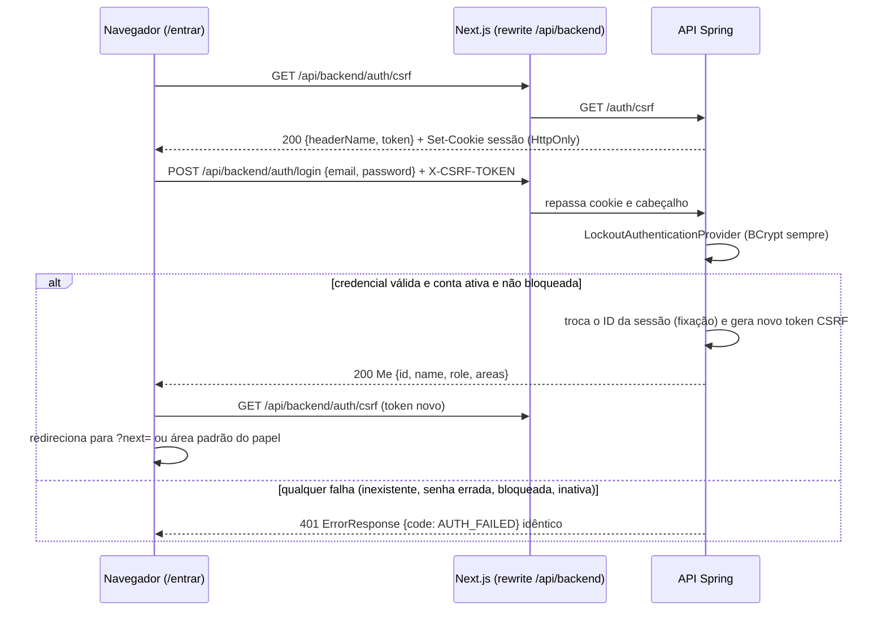
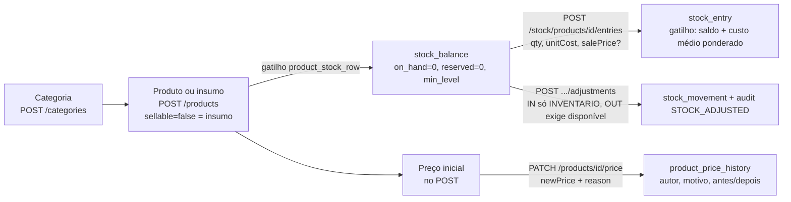

# SBI — Arquitetura de referência e plano de evolução

> Documento de trabalho local, na pasta `C:\Users\mathe\Documents\Programação\A3`. Fica fora dos repositórios Git e nunca é versionado.
> Versão 1.3, 14/10/2026 (14h25): marca SBI v1.0 em todas as telas (6.5, WP-EVO-9). Versão 1.2 (14h10): carga Olist por SQL puro com banco acessível na demonstração (6.4). Versão 1.1 (13h55): decisões da equipe sobre desconto (5.3) e Testcontainers (8); massa de demonstração Olist (6.4, WP-EVO-8). Versão 1, 14/10/2026. Continua o `SBI-PLANO-FECHAMENTO.md`. Escopo: autenticação e sessão, matriz de acesso (RBAC) e cadastro de usuários, catálogo/estoque/preço/desconto, clientes.
> Quem executa é um agente de desenvolvimento no IntelliJ. As seções 0 a 9 são instrução. O agente edita apenas a seção 10 (quadro de status) deste arquivo.

---

## 0. Como usar este documento

### 0.1 Pré-condição
Execute este plano somente depois que o `SBI-PLANO-FECHAMENTO.md` estiver com todos os itens da seção 7 concluídos. Se não estiver, conclua o fechamento primeiro e registre isso.

### 0.2 Ordem de leitura obrigatória
1. Este documento inteiro, uma vez.
2. No repositório (`A3\order-management-api`, `main` atualizada): `docs/decisoes/autenticacao-sessao-rbac.md`, `docs/decisoes/matriz-acesso.md`, `docs/decisoes/erp-pdv.md`, `docs/decisoes/regras-loja.md`, `docs/bd/modelo-erp-pdv.md`, `config/openapi/target-loja-gestao-openapi-2026-10-14-v4.json`.
3. Código de referência: `config/SecurityConfig.java`, `security/*`, `api/sales/*`, `api/customers/*`, `api/backoffice/*`, `src/test/resources/security/access-matrix.csv`, `security/AccessMatrixTest.java`.

### 0.3 Precedência (em conflito, vale a primeira)
1. Invariantes do `SBI-PLANO-MESTRE.md`, seção 5 (continuam válidas).
2. Invariantes novas da seção 2 deste documento.
3. Contrato v4/v5 e decisões publicadas em `docs/decisoes/*`.
4. Este documento.

### 0.4 Regras de trabalho
Valem integralmente as seções 4.1 a 4.4 do `SBI-PLANO-MESTRE.md` (modo contínuo, decisão autônoma, ações proibidas, commits e PRs). Registro em `A3\SBI-REGISTRO-EXECUCAO.md`, nova seção "Evolução — <data>", com decisões `D-EVO-nn` e ocorrências `O-EVO-nn`.

---

## 1. Diagnóstico: o que já existe e o que falta

Estado verificado na `main` (`a7f56f7`): 45/45 operações do contrato v4 com `x-status: implemented`, migrações V1 a V7, matriz executável com 69 linhas, frontend Next.js em TypeScript com schemas Zod gerados por Orval.

| Requisito | Situação na `main` | Lacuna |
| --- | --- | --- |
| Login, sessão HttpOnly, CSRF | Pronto: `HttpSessionCsrfTokenRepository`, `ChangeSessionIdAuthenticationStrategy`, cookie `http-only=true`, `secure` por variável, `same-site=lax`, timeout 30 min | **G-01** desativar usuário ou trocar papel não derruba sessões abertas |
| Bloqueio após 5 falhas | Pronto: `LoginAttemptService` (5 falhas, 15 min, resposta uniforme, BCrypt nos quatro casos) | **G-02** contador incrementado por leitura-modificação-gravação JPA sem `@Version`: tentativas paralelas perdem incremento (o bloqueio pode exigir mais de 5 falhas) |
| Hierarquia GERENTE > VENDEDOR, três barreiras | Pronto: `RoleHierarchy`, `@EnableMethodSecurity`, dono do dado com 404, `AccessMatrixTest` cobre todas as rotas mapeadas | Nenhuma estrutural |
| Cadastro de usuários e gerentes | **Inexistente**: usuários vêm de seed/configuração; não há `/users` no contrato | **G-03** CRUD de usuários, desbloqueio manual, troca de senha |
| Produtos, insumos, categorias, preço com motivo, histórico | Pronto (`/products`, `/categories`, PATCH `/price`, gatilho `product_price_history`) | Nenhuma |
| Estoque: entrada com custo médio, mínimo, reserva, baixa | Pronto (`stock_balance.reserved`, `v_alerta_estoque`, `belowMin`) | Nenhuma |
| Regras de desconto da equipe de vendas | Parcial: só promoções criadas pelo GERENTE (C-08, C-09) | **G-04** desconto manual com alçada por papel |
| Clientes PF/PJ, dígito verificador, mascaramento | Pronto (`DocumentFormat`, CHECKs da V5, `version`) | Nenhuma |
| Histórico de compras do cliente | Pronto (GET `/customers/{id}/orders`, visibilidade DEC-ERP-02) | **G-05** resumo do cliente (indicadores) para a interface rica |
| Testcontainers | **Não usado**: integração roda no PostgreSQL descartável do `docker-compose.test.yml` (porta 15432) | **G-06** divergência de documentação, não de código (seção 8) |

Conclusão: os quatro requisitos já têm a espinha dorsal implementada. O trabalho real são as lacunas G-01 a G-06; reescrever o que existe aumentaria risco a 6 semanas do prazo (29/11) sem ganho de nota.

---

## 2. Invariantes novas

1. Existe sempre pelo menos um GERENTE ativo. Nenhuma operação (rebaixar, desativar, apagar) pode zerar esse número; o banco garante com gatilho.
2. Ninguém altera o próprio papel nem desativa a si mesmo.
3. Alteração de papel, desativação, desbloqueio ou troca de senha invalida as sessões abertas do usuário afetado no próximo request.
4. Senha nunca trafega na resposta, nunca é registrada em log nem em `audit_event`.
5. Desconto manual nunca ultrapassa a alçada do papel da sessão; acima dela, só com aprovação de um GERENTE identificado e registrada no pedido.
6. Documento completo do cliente nunca sai da API para o VENDEDOR, em nenhuma rota (lista, perfil, histórico, pedido, exportação).

---

## 3. Autenticação, sessão e segurança

### 3.1 Fluxo da página de login (`/entrar`)



Regras da tela:
- Mensagem única de falha: "E-mail ou senha inválidos." com texto auxiliar fixo: "Após 5 tentativas incorretas, o acesso fica bloqueado por 15 minutos." A tela nunca diz se a conta existe ou está bloqueada (evita enumeração) [OWASP, Authentication Cheat Sheet, https://cheatsheetseries.owasp.org/cheatsheets/Authentication_Cheat_Sheet.html].
- Botão "Entrar" desabilitado durante o envio; `autocomplete="username"` e `autocomplete="current-password"`; foco no primeiro campo com erro; `aria-live="polite"` na mensagem.
- `?next=` aceito apenas se começar com `/` e não com `//` (evita redirecionamento aberto).
- Após login, o token CSRF antigo é inválido (`CsrfAuthenticationStrategy`); o cliente HTTP único (`lib/api/http.ts`) busca o novo antes da primeira mutação.

### 3.2 Sessão e cookie

| Item | Valor atual | Decisão |
| --- | --- | --- |
| Armazenamento | `HttpSession` em memória | Manter. Spring Session JDBC só se houver mais de uma instância da API (não há) |
| `HttpOnly` | `true` | Manter (invariante) |
| `Secure` | `${SESSION_COOKIE_SECURE:true}` | Manter; `false` só no perfil local sem TLS |
| `SameSite` | `Lax` | Manter `Lax` + CSRF. `Strict` é opcional: o front fala com a API pela mesma origem (rewrite), então não quebra chamadas, mas força novo login ao chegar por link externo |
| Nome | padrão do contêiner | Opcional (D-EVO): prefixo `__Host-` exige `Secure`, `Path=/` e sem `Domain`; aplicar só no perfil `demo`/produção e ajustar o `proxy.ts`, que verifica o nome do cookie [MDN, Set-Cookie, https://developer.mozilla.org/en-US/docs/Web/HTTP/Headers/Set-Cookie] |
| Ociosidade | 30 min | Manter |
| Duração absoluta | inexistente | **Novo (opcional):** 10 h (um turno). Atributo `LOGIN_AT` na sessão; o filtro da seção 3.4 encerra a sessão vencida |

O token de sessão não pode ir para `localStorage` nem para cabeçalho `Authorization`: a escolha de sessão HttpOnly + CSRF é justamente para que JavaScript não leia o identificador [OWASP, Session Management Cheat Sheet, https://cheatsheetseries.owasp.org/cheatsheets/Session_Management_Cheat_Sheet.html].

### 3.3 CSRF
- Já implementado: token sincronizado guardado na sessão, exigido em todo `POST/PUT/PATCH/DELETE`; `/auth/login` também exige token (login CSRF).
- O deploy da Vercel deve continuar chamando a API pela mesma origem (`/api/backend/:path*` → `BACKEND_ORIGIN`). Chamada direta entre origens exigiria `SameSite=None` e CORS com credenciais, o que enfraquece o desenho; não fazer [Spring, Cross Site Request Forgery, https://docs.spring.io/spring-security/reference/servlet/exploits/csrf.html].
- Teste a manter: mutação sem token responde 403 `CSRF_INVALID` no formato `ErrorResponse`.

### 3.4 G-01: revogação de sessão por versão (`session_version`)
Problema: `HttpSession` guarda o `AppPrincipal` com o papel do momento do login. Um VENDEDOR desativado ou um GERENTE rebaixado continua operando até a sessão expirar.

Solução sem infraestrutura nova:
1. Coluna `app_users.session_version integer NOT NULL DEFAULT 0` (V8).
2. `AppPrincipal` passa a carregar `sessionVersion` no login.
3. `SessionVersionFilter extends OncePerRequestFilter`, registrado depois do `SecurityContextHolderFilter`, para requisições autenticadas:
   ```java
   // uma leitura por chave primária por requisição
   var row = jdbc.sql("SELECT active, role, session_version FROM app_users WHERE id = :id")
                 .param("id", principal.id()).query(UserState.class).optional();
   if (row.isEmpty() || !row.get().active() || row.get().sessionVersion() != principal.sessionVersion()) {
       request.getSession(false).invalidate();
       SecurityContextHolder.clearContext();
       SecurityJson.write(response, 401, "SESSION_REVOKED", "Sua sessão foi encerrada. Entre novamente.");
       return;
   }
   ```
4. Toda operação da seção 4.4 que muda papel, `active`, senha ou bloqueio faz `session_version = session_version + 1` no mesmo `UPDATE`.
5. Se a duração absoluta (3.2) for adotada, o mesmo filtro a verifica.

Custo: uma consulta por PK por requisição, desprezível no volume de uma loja. Alternativa descartada: `SessionRegistry` em memória, que não sobrevive a reinício e duplica estado.

### 3.5 G-02: contador de falhas atômico
`AppUser.registerFailure()` incrementa em memória e grava com `save()`; `AppUser` não tem `@Version`. Duas tentativas concorrentes leem 3 e gravam 4. Correção no `LoginAttemptService.wrongPassword`:

```sql
UPDATE app_users
   SET failed_login_attempts = failed_login_attempts + 1,
       locked_until = CASE WHEN failed_login_attempts + 1 >= :max
                           THEN now() + make_interval(mins => :lockMinutes)
                           ELSE locked_until END
 WHERE id = :id
RETURNING failed_login_attempts, locked_until
```
- `now()` substituído por parâmetro vindo do `Clock` (`StoreTime`) para manter os testes determinísticos.
- Quando `locked_until` mudar, gravar `ACCOUNT_LOCKED` no `audit_event`.
- Sucesso: `UPDATE ... SET failed_login_attempts = 0, locked_until = NULL, last_login_at = :now`.
- Teste novo `CT-SEC-120`: 10 tentativas erradas em paralelo (`ExecutorService` + `CountDownLatch`) resultam em conta bloqueada e `failed_login_attempts >= 5`.

### 3.6 Opcional: limitação por origem
O bloqueio por conta não impede tentativa de muitas contas com uma senha comum (password spraying) e permite bloquear a conta de outra pessoa de propósito. Mitigação proporcional ao projeto: contador em memória por IP (janela de 15 min, 30 falhas → 429 `TOO_MANY_ATTEMPTS`), sem dependência nova. Registrar como `D-EVO` se implementar; não é requisito da disciplina.

### 3.7 Testes da seção
Existentes (manter verdes): `LoginLockoutIntegrationTest`, `LoginLockoutPolicyTest`, `SessionSecurityTest`, `ErrorContractTest`.
Novos: `CT-SEC-120` (concorrência do contador), `CT-SEC-121` (usuário desativado perde a sessão no próximo request: 401 `SESSION_REVOKED`), `CT-SEC-122` (rebaixado de GERENTE para VENDEDOR recebe 401 e, após novo login, 403 em `/products`), `CT-WEB-110` (Playwright: login, mensagem uniforme, `next` externo ignorado).

---

## 4. Matriz de acesso (RBAC) e cadastro de usuários

### 4.1 Modelo de papéis
- Uma tabela `app_users` com `role` referenciando `role(code, name, rank)` (já na V5: GERENTE 20, VENDEDOR 10). **Não criar tabela separada para gerentes**: gerente é um papel, não uma entidade; duas tabelas duplicariam login, bloqueio e auditoria.
- Hierarquia `ROLE_GERENTE > ROLE_VENDEDOR` (já configurada): tudo que o VENDEDOR acessa, o GERENTE acessa; o inverso nunca.

### 4.2 As três barreiras (mais a do banco)

| Barreira | Onde | Como | Resposta |
| --- | --- | --- | --- |
| 1. URL | `SecurityFilterChain` | `requestMatchers(método, caminho).hasRole(...)`; `anyRequest().denyAll()` no fim (negação por padrão) | 401 sem sessão, 403 sem papel |
| 2. Método | Serviços (`@PreAuthorize`) | `@PreAuthorize("hasRole('GERENTE')")` em todo caso de uso de gestão, mesmo que a URL já proteja (defesa em profundidade contra rota nova mal configurada) | 403 |
| 3. Dono do dado | Repositório | Filtro na própria consulta: `WHERE o.id = :id AND (:manager OR o.seller_id = :uid)`; objeto de outro dono é tratado como inexistente | **404**, nunca 403 (não confirma existência) |
| 4. Banco | PostgreSQL | `db_role`, `app_current_user_id()`, views `security_barrier`/`security_invoker`, gatilhos (`promotion_only_manager`) | violação vira 403/409 no `GlobalExceptionHandler` |

Matriz executável:
- `src/test/resources/security/access-matrix.csv` (`method,path,anonymous,vendedor,gerente`) é a fonte de verdade.
- `AccessMatrixTest` já percorre `RequestMappingHandlerMapping` e falha se uma rota mapeada não estiver no CSV. Regra: **rota nova, linha nova no CSV e regra na `SecurityFilterChain` no mesmo commit**.
- `MethodSecurityHierarchyTest` cobre a barreira 2 chamando o serviço sem passar pela URL.

### 4.3 G-03: dados do usuário (V8)

```sql
-- V8__user_admin_and_session_version.sql
ALTER TABLE app_users
    ADD COLUMN session_version      integer     NOT NULL DEFAULT 0,
    ADD COLUMN must_change_password boolean     NOT NULL DEFAULT false,
    ADD COLUMN password_changed_at  timestamptz,
    ADD COLUMN updated_at           timestamptz NOT NULL DEFAULT now(),
    ADD COLUMN created_by           bigint      DEFAULT app_current_user_id() REFERENCES app_users(id),
    ADD COLUMN version              integer     NOT NULL DEFAULT 0;

CREATE UNIQUE INDEX ux_app_users_email_lower ON app_users (lower(email));

-- Invariante 2.1: sempre um GERENTE ativo
CREATE OR REPLACE FUNCTION trg_keep_one_active_manager() RETURNS trigger LANGUAGE plpgsql AS $$
BEGIN
  IF NOT EXISTS (SELECT 1 FROM app_users WHERE role = 'GERENTE' AND active) THEN
    RAISE EXCEPTION 'at least one active manager is required' USING ERRCODE = 'P0001';
  END IF;
  RETURN NULL;
END $$;

CREATE CONSTRAINT TRIGGER keep_one_active_manager
  AFTER UPDATE OF role, active OR DELETE ON app_users
  DEFERRABLE INITIALLY DEFERRED
  FOR EACH ROW EXECUTE FUNCTION trg_keep_one_active_manager();
```
- Antes de criar o índice único, a migração verifica duplicidade por `lower(email)` e falha com mensagem clara (mesmo padrão dos blocos `DO $$` da V5).
- Se a V8 já existir quando este plano começar, use a próxima versão livre. Nunca edite migração publicada.
- `P0001` desse gatilho é mapeado para 409 `LAST_MANAGER`.

### 4.4 G-03: endpoints de usuários (contrato v5, `x-status: planned` até ter teste)

| Método e caminho | Papel | Regras | Sucesso / erros |
| --- | --- | --- | --- |
| GET `/users?q=&role=&active=&page=&size=` | GERENTE | paginação C-18; nunca devolve hash | 200 `Page<UserSummary>` |
| POST `/users` | GERENTE | `{name 3..120, email, role, temporaryPassword}`; e-mail normalizado em minúsculas; `must_change_password=true` | 201; 409 `STATE_CONFLICT` (e-mail) |
| GET `/users/{id}` | GERENTE | inclui `lockedUntil`, `failedLoginAttempts`, `lastLoginAt` | 200; 404 |
| PUT `/users/{id}` | GERENTE | só `name` e `email`, com `version` (412/409 em conflito) | 200; 409 |
| PATCH `/users/{id}/role` | GERENTE | `{role, reason 5..200}`; proibido no próprio id; incrementa `session_version` | 200; 409 `SELF_CHANGE_FORBIDDEN`, `LAST_MANAGER` |
| PATCH `/users/{id}/status` | GERENTE | `{active, reason}`; mesmas proibições; incrementa `session_version` | 200; 409 |
| POST `/users/{id}/unlock` | GERENTE | zera contador e `locked_until`; audita `ACCOUNT_UNLOCKED` | 204 |
| POST `/users/{id}/password-reset` | GERENTE | `{temporaryPassword}`; `must_change_password=true`; incrementa `session_version` | 204 |
| PUT `/auth/password` | autenticado | `{currentPassword, newPassword}`; política 4.5; incrementa `session_version` e renova a sessão atual | 204; 400 `VALIDATION_FAILED`; 401 senha atual errada (conta para o bloqueio) |

- DELETE de usuário não existe: usuário com pedidos é referência histórica (FK `orders.seller_id`). Desativar substitui apagar.
- `must_change_password=true` faz o `/auth/me` devolver `areas: ["TROCAR_SENHA"]`; o `SessionVersionFilter` (ou um filtro irmão) responde 403 `PASSWORD_CHANGE_REQUIRED` a qualquer rota que não seja `/auth/me`, `/auth/password`, `/auth/csrf`, `/auth/logout`.
- Toda operação grava `audit_event` (`USER_CREATED`, `USER_ROLE_CHANGED`, `USER_STATUS_CHANGED`, `ACCOUNT_UNLOCKED`, `PASSWORD_RESET`, `PASSWORD_CHANGED`) com autor e motivo, sem senha.
- Pacote: `api/users/` no padrão Controller → Service (`@PreAuthorize`, `@Transactional`, `DbSessionContext.apply`) → Repository (`JdbcClient`) → `UsersDtos`.
- Primeiro GERENTE: continua vindo do seed demo/variável de ambiente (`SBI_DEMO_PASSWORD`); não existe auto-cadastro público.

### 4.5 Política de senha
- Mínimo 12 caracteres, máximo 128, sem regra de composição obrigatória; rejeitar senha igual ao e-mail e uma lista curta de senhas comuns versionada em `src/main/resources/security/common-passwords.txt` [NIST, SP 800-63B, https://pages.nist.gov/800-63-4/sp800-63b.html].
- BCrypt com o custo atual do `PasswordEncoder`; nunca reduzir.
- Validador `@StrongPassword` (Bean Validation) para que a violação saia como 400 `VALIDATION_FAILED` com `fields[]`, coerente com o tema do projeto.

### 4.6 Tela `/gestao/usuarios` (GERENTE)
- Tabela: nome, e-mail, papel, situação (Ativo, Inativo, Bloqueado até HH:MM), último acesso.
- Ações em painel lateral: Cadastrar usuário, Editar dados, Alterar papel (com motivo), Ativar/Desativar (com motivo), Desbloquear, Redefinir senha.
- Linha do próprio usuário sem as ações proibidas (o servidor continua sendo a autoridade).
- Tela `/conta/senha` para todos, aberta automaticamente quando `must_change_password`.

### 4.7 Linhas novas da matriz (exemplo)
```
GET,/users,DENY,DENY,PERMIT
POST,/users,DENY,DENY,PERMIT
PATCH,/users/{id}/role,DENY,DENY,PERMIT
POST,/users/{id}/unlock,DENY,DENY,PERMIT
PUT,/auth/password,DENY,PERMIT,PERMIT
```
(Use os valores de célula que o CSV atual usa para anônimo e para negação: 401 vs 403, conforme o `AccessMatrixTest`.)

### 4.8 Testes da seção
`CT-USR-101` cadastro e e-mail duplicado (inclusive caixa diferente); `CT-USR-102` VENDEDOR 403 em todas as rotas `/users`; `CT-USR-103` rebaixar o último GERENTE → 409 `LAST_MANAGER` (serviço e, isoladamente, gatilho via SQL); `CT-USR-104` alterar o próprio papel → 409; `CT-USR-105` desbloqueio permite login imediato; `CT-USR-106` senha temporária obriga troca; `CT-USR-107` nenhuma resposta e nenhum `audit_event` contém senha ou hash; `CT-BD-30` gatilho `keep_one_active_manager` no job `bd`.

---

## 5. Catálogo, estoque, precificação e descontos

### 5.1 Fluxo de inclusão no backoffice (já implementado; manter)



Regras a preservar:
- Preço só muda por PATCH `/price` com motivo de 5 a 200 caracteres; `DbSessionContext.apply(user, reason)` antes do `UPDATE`; o gatilho grava o histórico. O PUT do produto não aceita preço (propriedade desconhecida → 400).
- Situação só por PATCH `/status`. DELETE de produto já vendido → 409 `RESOURCE_IN_USE`.
- SKU em maiúsculas, único; duplicado → 409 `STATE_CONFLICT`.
- Insumo (`sellable=false`) entra em estoque e custo, mas não aparece no `/sales/catalog` nem no `/sales/quote`.
- Custo médio ponderado calculado só no banco (gatilho `stock_entry_apply`): `novo_custo = (saldo × custo_atual + qtd × custo_unitário) / (saldo + qtd)`, NUMERIC com HALF_UP. A API não recalcula.
- Entrada com `salePrice` diferente do atual altera o preço com motivo "Entrada de estoque" (REC-a).

### 5.2 Estoque: alerta de mínimo e reserva

Estados por produto: `on_hand` (físico), `reserved` (comprometido em pedidos pendentes), `disponível = on_hand − reserved`; CHECKs `reserved >= 0` e `reserved <= on_hand`.

| Evento | Operação atômica | Falha |
| --- | --- | --- |
| Pedido criado (`PENDING_PAYMENT`) | `UPDATE stock_balance SET reserved = reserved + :q WHERE product_id = :p AND on_hand - reserved >= :q` (itens em ordem crescente de `product_id`) | 0 linhas → 409 `STOCK_INSUFFICIENT` com o disponível |
| Pagamento confirmado | `on_hand -= q, reserved -= q` + `stock_movement OUT SALE` | — |
| Cancelamento | `reserved -= q` | — |
| Estorno | conforme `docs/decisoes/erp-pdv.md` (não devolve estoque automaticamente, salvo decisão registrada) | — |

Alerta de mínimo: `disponível <= min_level` (view `v_alerta_estoque`, filtro `belowMin=true`, contador no `/gestao` e em `/gestao/estoque`). Evolução opcional: reservas de boleto com prazo; job `@Scheduled` cancela pedidos `PENDING_PAYMENT` mais antigos que N dias e libera a reserva (registrar como `D-EVO`; exige decisão da equipe sobre o prazo).

### 5.3 Descontos

**Atual (manter):** promoções criadas só pelo GERENTE (gatilho `promotion_only_manager`), PERCENT 1..100 ou AMOUNT, escopo produto/categoria/loja, vigência; o servidor escolhe a de maior desconto por unidade (empate: menor id); promoção inválida ou vencida no pedido → 409 (C-08, C-09). Cálculo em `Pricing` com HALF_UP.

**G-04 (novo): desconto manual com alçada.** Para negociação no balcão, sem abrir mão do invariante "preço calculado só no servidor".

Modelo (V9):
```sql
CREATE TABLE discount_policy (
    role             varchar(20)  PRIMARY KEY REFERENCES role(code),
    max_percent      numeric(5,2) NOT NULL CHECK (max_percent BETWEEN 0 AND 100),
    allow_below_cost boolean      NOT NULL DEFAULT false,
    updated_by       bigint       DEFAULT app_current_user_id() REFERENCES app_users(id),
    updated_at       timestamptz  NOT NULL DEFAULT now()
);
INSERT INTO discount_policy(role, max_percent, allow_below_cost) VALUES ('VENDEDOR', 5.00, false), ('GERENTE', 20.00, false);

ALTER TABLE orders
    ADD COLUMN manual_discount        numeric(12,2) NOT NULL DEFAULT 0 CHECK (manual_discount >= 0),
    ADD COLUMN manual_discount_reason varchar(200),
    ADD COLUMN discount_approved_by   bigint REFERENCES app_users(id),
    ADD CONSTRAINT ck_orders_manual_discount_reason
        CHECK (manual_discount = 0 OR manual_discount_reason IS NOT NULL);
```
**Decisão da equipe (14/10, definitiva):** alçada de 5% para VENDEDOR e 20% para GERENTE, `allow_below_cost=false` para os dois. Registre em `docs/decisoes/regras-loja.md` como decisão da equipe e use estes valores no seed e nos testes. A tabela `discount_policy` entra na próxima migração livre (a V9 citada acima é só referência; V8, V9 e V10 já foram usadas).

Regras:
1. Requisição de cotação e pedido ganha `manualDiscount: {percent, reason}` opcional. Nunca valor final, nunca preço.
2. Ordem de cálculo: subtotal bruto → promoções por item → desconto manual sobre o subtotal já promocionado → total. Arredondamento HALF_UP em cada etapa, como hoje.
3. `percent <= max_percent` do papel da sessão; acima → 403 `DISCOUNT_ABOVE_LIMIT` com `limitPercent` no corpo.
4. Se `allow_below_cost=false` e o total líquido de algum item ficar abaixo do custo médio conhecido → 409 `BELOW_COST` (para o VENDEDOR, a mensagem não revela o custo; invariante DOM-03).
5. Aprovação acima da alçada: o vendedor pede ao gerente; o GERENTE aplica no pedido pendente por `POST /sales/orders/{id}/discount-approval {percent, reason}` (grava `discount_approved_by`, recalcula total, audita `DISCOUNT_APPROVED`). Não há "senha do gerente digitada no caixa do vendedor": compartilhar credencial quebra a rastreabilidade.
6. `PUT /discount-policy/{role}` (GERENTE) altera a alçada com motivo e auditoria.
7. Relatório: `v_uso_promocoes` ganha a contrapartida `v_descontos_manuais` (vendedor, pedidos, valor concedido, aprovados por gerente).

Testes: `CT-DISC-101` dentro da alçada; `CT-DISC-102` acima → 403; `CT-DISC-103` abaixo do custo → 409 sem expor custo; `CT-DISC-104` aprovação do gerente; `CT-DISC-105` desconto manual com promoção (ordem de cálculo, centavos); `CT-DISC-106` total enviado pelo cliente é ignorado/rejeitado (400 por propriedade desconhecida).

**Recomendação de escopo:** G-04 é a maior mudança do documento (contrato, cálculo, PDV, BI). Se o prazo apertar, entregue só G-01, G-02, G-03 e G-05 e registre G-04 como trabalho futuro no relatório final. Uma regra de desconto mal testada é pior para a nota do que a ausência dela.

---

## 6. Gestão de clientes

### 6.1 Modelo (já na V5; manter)
- `customer.customer_type IN ('INDIVIDUAL','CORPORATE')`; `cpf` 11 dígitos ou `cnpj` 14 dígitos, só dígitos, coerentes com o tipo (`ck_customer_document_type`); `version` para concorrência otimista; `created_by`.
- Dígito verificador validado no serviço/DTO (módulo 11 de CPF e CNPJ). Recomendação: expor como anotação `@CpfCnpj` de Bean Validation, para que a violação apareça em `fields[]` do `ErrorResponse` e no contrato (`x-constraint`), reforçando o tema do projeto.
- Unicidade de documento: confirmar índice único parcial por `cpf` e por `cnpj`; se não existir, criar na próxima migração com verificação prévia de duplicados. Duplicado → 409 `STATE_CONFLICT`.
- CNPJ alfanumérico: a Receita Federal passou a emitir CNPJ com letras a partir de 31/07/2026 para novas inscrições [Agência Gov, Implantação do CNPJ Alfanumérico ocorrerá a partir de 31 de julho, https://agenciagov.ebc.com.br/noticias/202607/implantacao-do-cnpj-alfanumerico-ocorrera-a-partir-de-31-de-julho]. O modelo atual (`^[0-9]{14}$`) rejeita esse formato, o que significa que a loja já não consegue cadastrar empresas abertas depois dessa data. Registrar como limitação conhecida em `docs/decisoes/` e, se a equipe decidir suportar, migrar o CHECK para `^[0-9A-Z]{12}[0-9]{2}$` e adaptar o cálculo do dígito (valor ASCII − 48).

### 6.2 Mascaramento
- Feito no servidor por `DocumentFormat.of(cpf, cnpj, full)`; `full = principal é GERENTE`. GERENTE: `123.456.789-09`; VENDEDOR: `***.456.789-**` e `**.345.678/0001-**`.
- O frontend nunca recebe o documento completo para "esconder" depois (invariante 2.6). Teste de contrato: para o VENDEDOR, nenhuma resposta de `/customers*`, `/sales/orders*` contém 11 ou 14 dígitos seguidos de documento cadastrado (`CT-CUS-120`, varre o JSON).
- Busca por documento continua possível para o VENDEDOR: ele digita o documento completo (o cliente está no balcão), a API compara por igualdade e devolve o registro mascarado. Busca parcial por dígitos não é permitida (evita enumeração).
- Edição pelo VENDEDOR não altera documento (já é a regra); GERENTE corrige com `version`.
- Base legal de minimização: LGPD, art. 6º, III (necessidade) [Brasil, Lei 13.709/2018, https://www.planalto.gov.br/ccivil_03/_ato2015-2018/2018/lei/l13709.htm].

### 6.3 G-05: interface rica de histórico
Já existe: GET `/customers/{id}/orders` paginado, com itens; total, vendedor e link só para pedidos próprios ou para o GERENTE (DEC-ERP-02).

Novo endpoint `GET /customers/{id}/summary`:

| Campo | GERENTE | VENDEDOR |
| --- | --- | --- |
| `firstPurchaseAt`, `lastPurchaseAt`, `ordersPaid` | loja toda | loja toda (contagem e datas não são dado sensível) |
| `totalSpent`, `averageTicket` | loja toda | **só pedidos do próprio vendedor** (`scope: "OWN"` no corpo) |
| `topProducts[]` (nome, quantidade) | loja toda | loja toda, sem valores |
| `paymentMix[]` | loja toda | só próprios |
| `refundsTotal` | sim | não |

- Fonte: view nova `v_cliente_resumo` (pedidos `PAID` e posteriores; estorno no mês do estorno, como no faturamento), lida por `JdbcClient` com `record`.
- Pendentes e cancelados fora dos totais; exibidos como contagem separada.

Tela `/clientes/[id]`:
- Cabeçalho: nome, tipo (PF/PJ), documento (mascarado conforme papel), telefone, e-mail, cliente desde.
- Faixa de indicadores: total comprado, ticket médio, pedidos, última compra (com "há N dias"); para o VENDEDOR, rótulo "Suas vendas para este cliente".
- Abas: Pedidos (tabela paginada com filtros de período e situação; linha expansível com itens), Produtos mais comprados, Dados cadastrais (edição com `version`; conflito → "Os dados mudaram; recarregue").
- Ação "Nova venda para este cliente" abre `/vender` com o cliente pré-selecionado.
- Acessibilidade conforme WP-3.12 do plano mestre (tabelas com `th scope`, alvos de 44 px, 320 px sem rolagem horizontal).

Testes: `CT-CUS-121` summary do GERENTE confere com o seed demo; `CT-CUS-122` summary do VENDEDOR soma só pedidos próprios; `CT-CUS-123` cliente sem compras devolve zeros e datas nulas (sem número fictício); `CT-WEB-111` perfil com axe sem violações nos dois papéis.


### 6.4 Massa de demonstração do histórico de clientes (Olist)

Objetivo: um histórico de compras realista e volumoso para a demonstração do perfil do cliente, sem mexer no seed que os testes usam.

Fonte: Brazilian E-Commerce Public Dataset by Olist, pedidos reais anonimizados de 2016 a 2018, licença CC BY-NC-SA 4.0 (uso acadêmico não comercial, com atribuição e mesma licença para o derivado) [Olist, Brazilian E-Commerce Public Dataset, https://www.kaggle.com/datasets/olistbr/brazilian-ecommerce].

O recorte já está pronto, fora do repositório, em `A3\dados\olist`:
- `raw/`: CSVs originais (não versionar; cerca de 50 MB).
- `montar_recorte.py`: gera o recorte de forma determinística (`python montar_recorte.py`).
- `demo/clientes.csv` (60 clientes: 40 recorrentes, até 14 pedidos cada, e 20 com um pedido; 8 PJ), `demo/produtos.csv` (220 produtos em 37 categorias), `demo/pedidos.csv` (219 pedidos), `demo/itens_pedido.csv` (238 linhas). Faturamento bruto do recorte: 26.040,01.

Adaptações feitas no recorte (documentar em `docs/bd/massa-demonstracao.md`):
- Olist não tem nome nem documento de cliente: nomes sintéticos, CPF/CNPJ gerados com dígito verificador válido a partir de hash, e-mail em `example.com` (domínio reservado). Nenhum dado pessoal real.
- Produtos não têm nome: `"<categoria> <código>"`; SKU `OL-<6 hex>`; `custo_medio_demo` = 55% a 70% do preço (sintético, só para margem e lucro aparecerem).
- Datas comprimidas para os últimos 365 dias: a coluna `dias_atras` é relativa à data da carga, então o histórico nunca envelhece.
- Pagamento: o de maior valor de cada pedido; `credit_card`/`debit_card` → CARD (4 últimos dígitos sintéticos), `boleto` → BOLETO, `voucher` → PIX. Pedidos só `delivered` → PAID. Vendedor distribuído entre três vendedores demo (`VENDEDOR_1..3`, mapeie para as contas do seed demo).

Implementação (WP-EVO-8) — decisão da equipe em 14/10 (v1.2): carga por SQL puro, executada com `psql`, no padrão do pacote `docs/bd/pacote-sql`. Motivo: o professor de Banco de Dados pede "banco de dados funcional onde é possível fazer os comandos de SQL e CRUD"; a carga em SQL (COPY, INSERT ... SELECT, transação) é ela mesma evidência para a disciplina, e o banco precisa estar acessível a um cliente SQL durante a apresentação. A migração repetível do Flyway (versão 1.1 deste item) fica descartada.

1. Dados: copie `A3\dados\olist\demo\*.csv` para `docs/bd/pacote-sql/olist/` com `NOTICE.md` (fonte, licença CC BY-NC-SA 4.0, adaptações) e `montar_recorte.py`. Não versione `raw/`.
2. `docs/bd/pacote-sql/07_carga_olist.sql` (executado como superusuário do banco demo, depois do Flyway), em uma transação:
   - `CREATE SCHEMA IF NOT EXISTS stg_olist` e tabelas de staging com os mesmos campos dos CSVs;
   - `\copy stg_olist.<tabela> FROM 'olist/<arquivo>.csv' WITH (FORMAT csv, HEADER true)`;
   - limpeza idempotente da carga anterior (SKU `OL-%`, clientes da massa e dependentes, na ordem das FKs);
   - `INSERT ... SELECT` para categorias → produtos (gatilho cria `stock_balance`) → `stock_entry` (quantidade vendida + saldo restante, `custo_medio_demo`; gatilho calcula custo médio) → clientes → pedidos e itens com `CURRENT_DATE - dias_atras` + `hora` em America/Fortaleza → pagamentos (só `card_last4`) → `stock_movement` OUT SALE e baixa de `on_hand`;
   - autoria pelo mecanismo existente (`set_config` da sessão / `app_current_user_id()`), nunca NULL explícito;
   - consultas de conferência no fim (contagens e soma = 26.040,01) e `COMMIT`.
3. `docs/bd/pacote-sql/08_crud_clientes_olist.sql`: roteiro da apresentação no mesmo estilo do `05_crud_exemplos.sql` (tudo em `BEGIN ... ROLLBACK`):
   - CREATE: cadastrar cliente PF e PJ (inclui uma violação de CHECK/dígito para mostrar a integridade recusando);
   - READ: histórico completo de um cliente recorrente (JOIN cliente → pedidos → itens → produtos → pagamento), ranking dos 10 melhores clientes, ticket médio por UF, `v_cliente_resumo`;
   - UPDATE: telefone/e-mail do cliente; preço de produto com motivo (mostra `product_price_history`);
   - DELETE: cliente sem pedidos (sucesso) e cliente com pedidos (FK impede; mostrar a mensagem).
4. Acesso ao banco na demonstração: no `docker-compose.demo.yml`, publique a porta do serviço `db` só em `127.0.0.1` (ex.: `"127.0.0.1:5433:5432"`), para conectar pelo painel Database do IntelliJ, DBeaver ou `psql`. Mantenha o `tmpfs`: cada `up` começa limpo e reproduzível. Documente no README a string de conexão sem senha (a senha vem de `SBI_DB_PASSWORD`).
5. Script de execução `docs/bd/pacote-sql/run_demo_olist.sh` e equivalente PowerShell `scripts/demo-olist.ps1`: sobe o compose demo, espera o `api` saudável (Flyway aplicado), roda `07_carga_olist.sql` via `docker compose exec -T db psql` e imprime as contagens.
6. Os perfis padrão, `integration` e `contract` e o job `bd` atual continuam sem a carga: nenhum número dos testes (BD-01..BD-31, 186.400 em 65 pedidos) pode mudar. Acrescente ao job `bd` uma etapa separada que roda `07` e `08` e verifica as conferências.
7. Testes (no job `bd`, saída PASS/FAIL como os 06*): `CT-DEMO-01` contagens e soma; `CT-DEMO-02` cliente com 14 pedidos com histórico completo e resumo coerente com o CSV; `CT-DEMO-03` rodar `07` duas vezes não duplica; `CT-DEMO-04` estoque nunca negativo e `reserved = 0` após a carga; `CT-DEMO-05` pela API, VENDEDOR vê documento mascarado também na massa Olist.
8. Roteiro de demonstração: depois do login, abrir o perfil de um cliente recorrente na tela; em seguida, no IntelliJ (Database), rodar `08_crud_clientes_olist.sql` e mostrar a mesma informação via SQL.


### 6.5 Marca SBI v1.0 em todas as telas (WP-EVO-9)

Fonte de verdade: manual de marca "SBI · Manual de Marca" v1.0 (outubro de 2026) e protótipo "SBI — Protótipo e Manual de Marca" (telas Entrar, Gestão, Vender, Vender no celular, Meu desempenho, Estoque, Produtos e preços, Promoções, Análises). O nome do sistema é **SBI — Super Business Intelligence**. Em conflito com o "Design SBI v1.1" do `SBI-PLANO-MESTRE.md` (WP-3.12), **vale o manual v1.0**; registre como `D-EVO` e marque a WP-3.12 como substituída em `docs/decisoes/`.

Arquivos prontos, fora do repositório, em `A3\marca\aplicacao\frontend\` (copie para os mesmos caminhos em `frontend/`, revise e ajuste ao código atual):
- `components/brand/logo.tsx`: `SbiSymbol` e `SbiLogo` (horizontal, com descritor, vertical; variantes principal, negativa, sobre Índigo, monocromática), geometria exata do manual, nome acessível "SBI — Super Business Intelligence".
- `components/brand/icons.tsx`: os 6 ícones do manual (visão geral, vender, estoque, preço, promoção, análises) e 7 derivados na mesma construção (clientes, vendas, desempenho, usuários, senha, sair, check).
- `app/icon.svg`: favicon (o App Router serve `app/icon.svg` automaticamente). Gere também `app/apple-icon.png` (180 px) e um PNG de 512 px a partir do mesmo SVG.
- `app/brand-tokens.css`: tokens do manual, com aliases para os nomes atuais de `globals.css` (`--bg`, `--primary`, `--radius`...), para migrar sem quebrar telas.

Mudanças globais:
1. **Fontes** (`app/layout.tsx`): acrescente `Space_Grotesk` (pesos 500, 600, 700, variável `--font-space-grotesk`); Plex Sans 400/500/600; Plex Mono 500. Títulos (h1, h2, h3) e logo em Space Grotesk 600/700; texto em Plex Sans; valores monetários, SKU, número de pedido e IDs em Plex Mono 500 com `tabular-nums`. Sem itálico. Nada abaixo de 13 px.
2. **Tokens** (`globals.css`): importe `brand-tokens.css` primeiro e troque os valores divergentes: `--line` #DDE1E8; hover do botão principal #2B39A8 (hoje #3141BD); raio 10 nos controles e **14 nos cartões** (hoje 18); **cartões com borda 1 px #DDE1E8** (hoje sem borda); item ativo do menu com fundo #EBEDFC e texto #2B39A8 600; selo informativo #2B39A8/#EBEDFC. Proporção: 70% branco/névoa, 20% tinta, 8% índigo, 2% menta. Menta nunca como texto sobre branco.
3. **Metadados**: `title: { default: 'SBI — Super Business Intelligence', template: '%s · SBI' }`; `description: 'Gestão de loja com vendas, estoque e metas em um só lugar.'`; `themeColor` #141B26; `lang="pt-BR"`.
4. **Shell** (`app/(app)/layout.tsx`, `components/nav-links.tsx`, `lib/areas.ts`): `SbiLogo` horizontal (36 px) no topo da barra lateral no lugar do texto "SBI"; menu agrupado em seções com rótulo em caixa alta 12 px Ardósia — GESTÃO (Visão geral, Produtos e preços, Promoções, Estoque, Análises, Usuários), ATENDIMENTO (Vender, Vendas, Clientes), MEU ESPAÇO (Meu desempenho, Trocar senha) — só as áreas que o usuário tem; cada item com `Icon` + texto; `aria-current="page"` no ativo. Rodapé com avatar de iniciais (Tinta para gerente, Índigo para vendedor), nome, papel ("Gerente"/"Vendedor") e "Sair" com ícone e texto. Em telas estreitas a barra vira faixa superior com o símbolo de 30 px e o menu recolhível (alvo de 44 px).
5. **Carregamento e erros**: `app/loading.tsx` e `app/(app)/loading.tsx` com assinatura vertical centralizada sobre Névoa, sem animação nem frases; `not-found.tsx` e `error.tsx` com o logo e mensagem no padrão de voz ("Página não encontrada." / "Não foi possível carregar. Tente de novo.").
6. **Voz** (`lib/api/messages.ts` e textos das telas): tabela "Escreva/Evite" do manual. Botões começam com verbo ("Criar pedido", "Salvar preço", "Confirmar pagamento recebido"); nada de código HTTP, "Erro", "Ops", exclamação ou emoji; permissão: "Só o gerente pode alterar preços."; estoque: "Estoque insuficiente: restam N unidades."; nunca comparar vendedores na tela de outro vendedor. Glossário: Pedido, Receita (pagamentos confirmados menos estornos), Estorno, Reserva, Promoção.
7. **Formatos** (`lib/format.ts`): moeda `R$ 1.234,56`; data `12/10/2026`; período `01/09 a 30/09/2026`; percentual `12,5%`; hora `14h30`; dado ausente "Não informado" (nunca zero). Testes unitários para cada formato.
8. **Gráficos** (`components/charts.tsx`): ordem de cores `--data-1..4`; série única só Índigo; eixo começa no zero com marcas redondas; meta como linha âmbar #B26400 tracejada **com rótulo** ("Meta R$ 47 mil"); título da seção diz a conclusão; legenda com período e origem; mais de 4 séries agrupa em "Outros".
9. **Estados** (selos): Pago #14684F/#E3F6EF; Aguardando pagamento #8A4C00/#FFF6E5; Cancelado #B42318/#FDECEA; Novo/Informação #2B39A8/#EBEDFC. Sempre com texto. Selo de fundo cheio âmbar usa #8A4C00 (nunca branco sobre #B26400).
10. **Nome**: "SBI" em caixa alta, sem pontos; "o SBI"; primeira menção em texto longo "SBI (Super Business Intelligence)". Proibidas: as grafias listadas no CT-WEB-125 (`frontend/tests/brand.test.ts`). Acrescente um teste Node que varre `frontend/app`, `frontend/components`, `frontend/lib` e `docs/` por essas formas.

Tela a tela (compare com o protótipo correspondente; mantenha comportamento, rotas, testes e acessibilidade atuais):
| Rota | Referência | Aplicação |
| --- | --- | --- |
| `/entrar` | 01 · Entrar | Duas colunas: painel Tinta com `SbiLogo` descritor variante negativa, título "A loja inteira em um só lugar: venda, estoque e meta.", texto "Cada pessoa entra com a própria conta. O gerente vê a loja; o vendedor vê o próprio resultado." e rodapé "Ambiente de demonstração · dados fictícios · Projeto A3 · UNIFG 2026"; cartão do formulário com "Entrar no SBI", "Use o e-mail da loja.", campos de 48 px e **um único** botão "Entrar". Abaixo de 1024 px, o painel vira faixa superior compacta. Avisos de bloqueio e sessão encerrada mantidos. |
| `/gestao` | 02 · Gestão | Título "Visão geral da loja"; subtítulo "<mês> · somente pagamentos confirmados, descontados os estornos"; faixa única de indicadores em cartão (Faturamento confirmado, Meta da loja, Atingimento, Ticket médio) com valores em Plex Mono; "Evolução semanal" com meta âmbar tracejada; painel "Precisa de atenção" (estoque abaixo do mínimo, pedidos aguardando pagamento) e "Promoção ativa"; tabela "Vendedores e metas" com barra de atingimento Índigo e linha de total. Ação principal "Nova venda". |
| `/vender` | 03 · Vender e 05 · celular | Título "Nova venda" e "Responsável: <nome> · definido pela sua conta"; etapas como lista com `aria-current="step"` (concluída: Pago-verde com ícone `check`, atual: Índigo claro, futura: borda); cartão do cliente com documento mascarado; tabela de produtos com disponível, quantidade, promoção e subtotal em mono; resumo lateral (no celular, rodapé fixo com total e "Criar pedido"); texto "Ao criar, as unidades ficam reservadas...". |
| `/vendas`, `/vendas/[id]` | padrão Gestão | Tabelas com número do pedido em mono, selos de estado do item 9, ações "Confirmar pagamento recebido" e "Cancelar pedido" (botão de perigo #B42318). |
| `/clientes`, `/clientes/[id]` | padrão Gestão | Faixa de indicadores do resumo em mono; abas; documento mascarado para vendedor; "Nova venda para este cliente" como ação principal. |
| `/gestao/estoque` | 06 · Estoque | Contador "N abaixo do mínimo" com selo de atenção; colunas saldo, reservado, disponível, mínimo, custo médio em mono; painéis laterais de entrada e ajuste. |
| `/gestao/produtos` | 07 · Produtos e preços | Filtro Produtos · Insumos; preço em mono com ajuda "Mínimo: custo médio + 5%" quando aplicável; histórico de preço com autor e motivo. |
| `/gestao/promocoes` | 08 · Promoções | Selos de vigência; regra de alçada de desconto (5% vendedor, 20% gerente) visível quando o WP-EVO-5 existir. |
| `/gestao/analises` | 09 · Análises | Títulos que dizem a conclusão; paleta de dados na ordem; "Não informado" para ausentes. |
| `/meu-desempenho` | 04 · Meu desempenho | Meta como linha âmbar tracejada e nomeada; "Faltam R$ X para a sua meta."; nenhum dado de colegas. |
| `/gestao/usuarios`, `/conta/senha` | padrão Gestão / Entrar | Mesmo shell, ícones `usuarios` e `senha`; troca obrigatória de senha usa o layout do `/entrar`. |

Testes do pacote:
- Unitários: `SbiLogo` com nome acessível e geometria (atributos do SVG), `Icon` decorativo por padrão, formatos do item 7, varredura de nomes proibidos do item 10.
- Playwright: em todas as rotas e nos dois papéis, o logo está presente e visível; o item ativo tem `aria-current="page"`; axe WCAG 2.2 AA sem violações; 320 px sem rolagem horizontal (CT-WEB existentes continuam verdes). Crie `CT-WEB-120` (marca presente em todas as rotas) e `CT-WEB-121` (favicon servido em `/icon.svg`).
- Capturas de tela de cada rota (gerente e vendedor) em `reports/marca/` para o relatório final, sem dados pessoais reais.

---

## 7. Fluxo orientado a contrato (para toda lacuna)

1. Acrescente as operações novas no contrato como `target-loja-gestao-openapi-<data>-v5.json` (cópia do v4 + operações novas com `x-status: planned`). Nunca edite o v4 publicado.
2. Gere os schemas Zod (`npm run api:generate`) e confirme que nada existente quebrou.
3. Implemente backend com teste; só então mude para `x-status: implemented` (C-02).
4. `node scripts/audit-contract.mjs` e a verificação ao vivo (`scripts/test-contract.ps1`) com divergência zero.
5. Códigos de erro novos (`SESSION_REVOKED`, `LAST_MANAGER`, `SELF_CHANGE_FORBIDDEN`, `PASSWORD_CHANGE_REQUIRED`, `DISCOUNT_ABOVE_LIMIT`, `BELOW_COST`, `TOO_MANY_ATTEMPTS`) entram no enum de `ErrorResponse.code` do contrato e no `GlobalExceptionHandler` no mesmo commit; `ErrorContractTest` cobre cada um.
6. Atualize `config/openapi/baseline-errors-openapi-*.json` se o baseline de erros for comparado na CI.

---

## 8. G-06: Testcontainers

Fato: o projeto não usa Testcontainers; a integração roda no PostgreSQL do `docker-compose.test.yml` (porta 15432, perfil `integration`), com CI verde. Documentar "Testcontainers" na apresentação seria afirmar algo falso.

**Decisão da equipe (14/10): opção A.** Motivo: o enunciado dos professores (`ProjetoA3_20260910130739.pdf`) exige suíte automatizada, testes de integração e, idealmente, CI; não cita Docker nem Testcontainers. Testcontainers aparecia só no manual interno da equipe (`docs/referencias/Manual-Projeto-A3.md`, linhas "Docker + Testcontainers" e "PostgreSQL em Testcontainers"), que deve ser corrigido. Execute no WP-EVO-7: troque as menções a Testcontainers no manual, README, arquitetura, plano de qualidade e relatório por "PostgreSQL 18 descartável via Docker Compose (`docker-compose.test.yml`, porta 15432)" e registre a decisão como `D-EVO`. Não migre para Testcontainers.

Opções avaliadas:
- **A (recomendada para o prazo):** corrigir o discurso e a documentação: "PostgreSQL 18 descartável via Docker Compose". Custo zero, risco zero.
- **B:** migrar para Testcontainers com `@ServiceConnection` (`org.testcontainers:postgresql`, imagem `postgres:18`), mantendo o perfil `integration`. Ganho: o teste sobe o próprio banco no IntelliJ sem passo manual. Custo: tempo de CI maior e reescrita da configuração de limpeza por `BusinessTables.NAMES`. Só faça depois das lacunas G-01 a G-05 e em PR separado `test/testcontainers`.

---

## 9. Pacotes de trabalho e ordem

Base: `main` atualizada após o fechamento. Uma branch por pacote, PR para a `main`, CI verde, revisão de outro integrante (o agente não integra).

| Ordem | Pacote | Branch | Conteúdo | Corte |
| --- | --- | --- | --- | --- |
| 1 | WP-EVO-1 Contador atômico | `fix/login-attempt-atomic` | 3.5, `CT-SEC-120` | mínimo |
| 2 | WP-EVO-2 Usuários e revogação | `feat/user-admin` | V8, 3.4, 4.3 a 4.8, contrato v5, matriz, `/gestao/usuarios`, `/conta/senha` | mínimo |
| 3 | WP-EVO-3 Resumo do cliente | `feat/customer-summary` | 6.3, view `v_cliente_resumo`, tela `/clientes/[id]` | mínimo |
| 4 | WP-EVO-4 Validação de documento como Bean Validation | `refactor/cpf-cnpj-constraint` | 6.1 (`@CpfCnpj`), índice único se faltar, decisão sobre CNPJ alfanumérico | mínimo (a decisão), completo (o suporte) |
| 5 | WP-EVO-5 Desconto com alçada | `feat/manual-discount` | 5.3 inteiro, V9, PDV e BI | completo |
| 6 | WP-EVO-6 Opcionais | `feat/session-hardening` | duração absoluta, `__Host-`, limitação por IP | opcional |
| 7 | WP-EVO-8 Massa Olist | `feat/demo-olist-dataset` | 6.4 inteiro (antes da documentação, para o roteiro já incluí-la) | mínimo |
| 8 | WP-EVO-9 Marca SBI v1.0 | `feat/brand-sbi-v1` | 6.5 inteiro, em todas as telas e nos dois papéis | mínimo |
| 9 | WP-EVO-7 Documentação | `docs/evolution` | `docs/decisoes/*` (D-EVO), `docs/arquitetura.md`, `docs/plano-testes.md`, `docs/rastreabilidade.md`, roteiro de demonstração (desativar vendedor e ver a sessão cair; tentar rebaixar o último gerente) | mínimo |

Para cada pacote: contrato primeiro (seção 7), migração, backend, testes, matriz, frontend, `.\mvnw.cmd -q verify`, `scripts\test.ps1 -Mode Integration`, `scripts\test-contract.ps1`, `cd frontend; npm test; npm run build; npx playwright test`, commit pequeno, push, PR com `--base main`.

Definição de pronto do plano:
- [ ] G-01 a G-03 e G-05 com testes verdes e `x-status: implemented`.
- [ ] Matriz executável cobrindo as rotas novas; `AccessMatrixTest` verde.
- [ ] Contrato ao vivo sem divergência.
- [ ] Job `bd` com o gatilho `keep_one_active_manager` testado.
- [ ] Decisões `D-EVO` publicadas; G-04 entregue ou registrado como trabalho futuro; G-06 decidido.
- [ ] Varredura de termos proibidos sem resultado (`python ..\tmp\scan_ai.py`).

---

## 10. Quadro de status (o agente atualiza)
Legenda: [x] pronto com teste verde · [~] parcial · [ ] não iniciado · [!] bloqueado (ver registro).

| Pacote | Situação | Branch / commit | PR | Observação |
| --- | --- | --- | --- | --- |
| WP-EVO-1 | [x] | `fix/login-attempt-atomic` / 814f043 | #23 | CT-SEC-120 verde (vermelho no código anterior); integração 546/0; D-EVO-02, D-EVO-03 |
| WP-EVO-2 | [x] | `feat/user-admin` / a7dcc2f | #24 | V8, contrato v5, /users e PUT /auth/password implemented; integração 605/0; contrato ao vivo 54/54 sem divergência; Playwright 16/16; bd 54 PASS; CI verde; D-EVO-04 a 13 |
| WP-EVO-3 | [x] | `feat/customer-summary` / cd3946c | #25 | V9 v_cliente_resumo, GET /customers/{id}/summary implemented; integração 611/0; contrato 55/55; Playwright 17/17; bd 57 PASS; CI verde; D-EVO-14 a 16 |
| WP-EVO-4 | [x] | `refactor/cpf-cnpj-constraint` / f4835c5 | #26 | decisão e suporte ao CNPJ alfanumérico (V10, @CNPJ ALPHANUMERIC); integração 625/0; Playwright 18/18; CI verde; D-EVO-17 a 19 |
| WP-EVO-5 | [x] | `feat/manual-discount` / 143eb09 | #27 | V11, alçada 5%/20% (decisão da equipe), aprovação do gerente, relatório; integração 649/0; contrato 58/58 sem divergência; Playwright 19/19; bd 60 PASS; CI verde; D-EVO-20 a 26 |
| WP-EVO-6 | Trabalho futuro (não executado) | — | — | decisão do responsável em 14/10 (D-EVO-27): duração absoluta, `__Host-` e limitação por IP ficam para depois |
| WP-EVO-8 | [x] | `feat/demo-olist-dataset` / 4b3f3c6 | #28 | carga Olist por SQL puro (07/08/09), porta 127.0.0.1:5433, scripts .sh/.ps1; CT-DEMO-01 a 06 verdes local e na CI (bd 60 + 10 PASS); D-EVO-28 a 31 |
| WP-EVO-9 | [x] | `feat/brand-sbi-v1` / de887e9 | #29 | tokens e favicon do manual, logo/ícones construídos da geometria do icon.svg (manual sem logo.tsx/icons.tsx), menu em seções, login em duas colunas, voz e formatos, meta tracejada; npm test 36/36, Playwright 24/24, contrato ao vivo 58/58, capturas em reports/marca (axe 0); CI verde; D-EVO-32 a 37 |
| WP-EVO-7 | [x] | `docs/evolution` / 92e7a6e | #30 | decisão A da seção 8 (D-EVO-38): Testcontainers trocado por PostgreSQL 18 descartável via Docker Compose em plano de testes, requisitos, stack, README, arquitetura, plano de qualidade e relatório; manual .md alinhado (92e7a6e; PDF histórico de 26/09 sem alteração); arquitetura, rastreabilidade (RF-24 a 26) e roteiro de 12 min (sessão cai, último gerente, Olist, inclui o #21, D-EVO-39); integração 649/0; CI verde |
