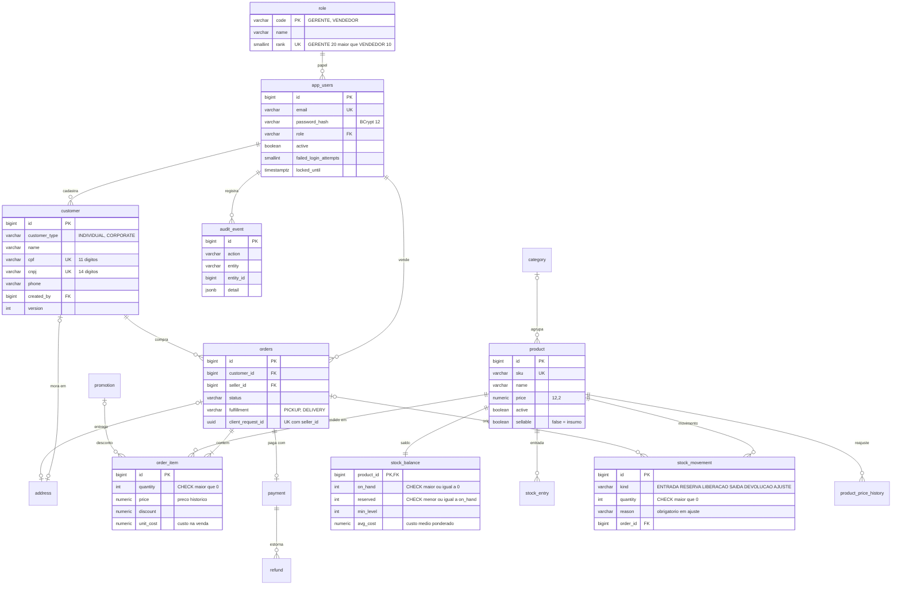

# SBI — Prompt de execução ERP/PDV (acesso, balcão, clientes e backoffice)

> Documento de trabalho local. Fica fora dos repositórios Git e não deve ser versionado.
> Complementa `SBI-EXECUCAO.md` e `SBI — Roteiro de conclusão do projeto A3.md`. Estado conferido em 14/10/2026 na `main` `57c3c70`.

---

## 1. Como usar no IntelliJ

1. **Pré-requisito.** A Fase 0 do `SBI-EXECUCAO.md` precisa estar integrada na `main` (squash na ordem #6 → #5 → #8 → #9 → #10 → #7 → #11). A ETAPA 1 roda antes disso. A ETAPA 2A não roda, porque as novas migrações dependem da `V4__money_numeric` (PR #9).
2. Abra a pasta `order-management-api` como projeto. Inicie uma sessão do plugin de agente configurado na seção "Preparação" do Roteiro.
3. Ajuste modelo e esforço com `/model` e `/effort` conforme a tabela abaixo.
4. Cole o bloco inteiro da seção 5. Na linha seguinte, escreva `Execute a ETAPA 1`.
5. Ao fim de cada etapa, a sessão para e entrega um relatório. Revise o diff e o relatório. Para seguir, abra uma nova sessão, cole o mesmo bloco e escreva, por exemplo, `Execute a ETAPA 2A — ETAPA 1 aprovada em 16/10`. Ajustes pedidos na revisão vão nas linhas seguintes.

| Etapa | Entrega | Modelo | Esforço | Fase do roteiro |
| --- | --- | --- | --- | --- |
| 1 Modelagem | ERD, DDL proposto, rascunho do contrato v4, matriz de acesso, estratégia de autenticação | Opus | xhigh | Fase 1 (desenho) |
| 2A Banco | V5, V6, seed demo, perfis de teste com Flyway, job `bd` na CI | Opus | xhigh | Fase 1 |
| 2B Segurança | sessão, hierarquia, bloqueio, matriz executável, contrato de erro | Opus | xhigh | Fase 2 |
| 2C Endpoints | PDV, clientes, backoffice, faturamento e os demais endpoints do roteiro | Opus | high | Fase 3 |
| 3 Frontend | TypeScript, telas, integração com a API | Opus | high | Fase 4 |
| 4 Testes e CI | suíte crítica completa, e2e, CI, métricas R1 | Opus | high | Fase 5 |

Os testes não ficam só para a ETAPA 4: cada etapa entrega os testes do que construiu. A ETAPA 4 fecha a suíte, a CI e as métricas.

---

## 2. Ajustes feitos ao pedido original

| Pedido | Adotado | Motivo |
| --- | --- | --- |
| Backend em Node.js + Fastify | Java 25 + Spring Boot 4.1 (existente) | A decisão A1 e o tema do A3 (Bean Validation + contrato OpenAPI) dependem do backend Spring. Reescrevê-lo descartaria os 176 testes da suíte integrada (execução da FIX-03 em 13/10), as migrações Flyway V1–V4 e a linha de base R0. |
| Zod no backend | Bean Validation: `@CPF`/`@CNPJ` do Hibernate Validator, restrição de classe para retirada × entrega, polimorfismo de pagamento | É o objeto de estudo de Qualidade de Software. As anotações brasileiras já existem no Hibernate Validator 9 [Hibernate, Package org.hibernate.validator.constraints.br, https://docs.hibernate.org/validator/9.0/api/org/hibernate/validator/constraints/br/package-summary.html]. |
| React com TypeScript e Zod | Next.js 16 migrado para TypeScript estrito; schemas Zod 4 gerados do contrato v4 com Orval | O contrato vira a única fonte de verdade, e a CI acusa divergência entre ele e o frontend [Orval, Zod, https://orval.dev/docs/guides/zod]. |
| JWT ou sessão | Sessão Spring com cookie HttpOnly e CSRF (decisão ARQ-01), mais hierarquia de papéis e bloqueio por tentativas | Já está implementada e testada. O logout e o bloqueio têm efeito imediato no servidor, sem lista de tokens revogados. |
| Tabelas Users, Roles, Customers, Products, Inventory, Orders, OrderItems | `app_users`, `role` (nova), `customer`, `product`, `stock_balance` + `stock_entry` + `stock_movement`, `orders`, `order_item` | Reaproveita o pacote SQL de 12/10, com 51 casos PASS, inclusive a corrida pela última unidade. |
| Baixa de estoque automática no PDV | Reserva atômica ao criar a venda; a reserva vira saída quando o vendedor confirma o pagamento recebido | Segue a regra DOM-10, já aprovada, e impede vender a mesma unidade duas vezes. |
| Faturamento em tempo real | Painel lendo as views do V6, com atualização a cada 15 s enquanto a aba está visível | SSE passando pelo rewrite do Next.js e pela sessão Spring traz mais risco do que ganho no volume de uma loja. |
| Gerente: Dashboard, Backoffice, Faturamento e Estoque. Vendedor: PDV e Clientes | Hierarquia GERENTE > VENDEDOR. O vendedor ganha Clientes (cadastro e perfil) e mantém Minhas vendas e Meu desempenho | Muda a matriz da seção 3 do `SBI-EXECUCAO.md` (marcado como DELTA no prompt). |
| Manter a consistência visual do painel publicado | A tela `/gestao` reproduz a estrutura do painel "Inteligência" com os tokens SBI v1.1. O site estático continua separado | Decisão A1. O domínio não tem "canal de venda", então a participação por canal vira participação por forma de pagamento. |

---

## 3. Visão para aprovação antecipada

### 3.1 Modelo-base (estado alvo após V5 e V6)

| Entidade pedida | Tabela(s) | Origem | Mudança proposta |
| --- | --- | --- | --- |
| Users | `app_users` | V2 | `active`, `failed_login_attempts`, `locked_until`, `last_login_at`, `created_at` |
| Roles | `role` | nova | `code` PK, `name`, `rank`; FK em `app_users.role` no lugar do CHECK |
| Customers | `customer` + `address` | V1/V3 | `phone`, `version`, `created_by`, `created_at`, `updated_at`; CPF/CNPJ só com dígitos; índice por nome |
| Products | `product` + `category` + `product_price_history` | V1 + pacote | `sellable` (falso = insumo); índice por nome |
| Inventory | `stock_balance` + `stock_entry` + `stock_movement` | pacote | tipos `AJUSTE_ENTRADA`/`AJUSTE_SAIDA` com motivo e observação |
| Orders | `orders` | V1/V2 | `client_request_id`, `request_hash`, `fulfillment` (padrão PICKUP); status `CANCELED`; índice cliente + data |
| OrderItems | `order_item` | V1 + pacote | já tem `discount`, `unit_cost` e `promotion_id` no pacote |
| Apoio | `payment`, `refund`, `promotion`, `monthly_goal`, `seller_goal` | V1 + pacote | status `EXPIRED` aceito no CHECK; cartão no balcão sem número completo |
| Auditoria | `audit_event` | nova | login, bloqueio, clientes, ajustes, cancelamentos |



### 3.2 Autenticação e autorização em uma tabela

| Camada | Mecanismo |
| --- | --- |
| Identidade | Sessão Spring: cookie HttpOnly, SameSite=Lax, Secure fora de dev, 30 min de inatividade, novo ID de sessão no login |
| Mutação | Token CSRF da sessão em todo POST, PUT, PATCH e DELETE |
| Força bruta | 5 falhas seguidas bloqueiam a conta por 15 min. Senha errada, usuário inexistente, conta bloqueada e conta inativa recebem a mesma resposta, e o BCrypt roda nos quatro casos para não haver diferença de tempo. A OWASP cita 5 a 10 tentativas e 5 a 30 min como faixa usual [OWASP, WSTG — Testing for Weak Lock Out Mechanism, https://wstg.owasp.org/latest/4-Web_Application_Security_Testing/04-Authentication_Testing/03-Testing_for_Weak_Lock_Out_Mechanism] |
| Barreira 1 | Regras de URL na `SecurityFilterChain`; o que não está listado é negado |
| Barreira 2 | `@PreAuthorize` nos casos de uso, com `RoleHierarchy` GERENTE > VENDEDOR também na segurança de método [Spring, Method Security, https://docs.spring.io/spring-security/reference/7.0/servlet/authorization/method-security.html] |
| Barreira 3 | Dono do dado verificado no serviço. Pedido de outro vendedor responde 404 |
| Interface | `proxy.ts` (substituto do `middleware` no Next.js 16) redireciona quem não tem sessão. O layout de servidor consulta `/auth/me`. O menu vem de `areas`. A API continua sendo a autoridade [Vercel, proxy.js, https://nextjs.org/docs/app/api-reference/file-conventions/proxy] |
| Prova | A matriz de acesso fica em CSV e roda como teste parametrizado. Uma rota sem linha na matriz quebra o build |

---

## 4. Decisões pendentes (opção padrão se ninguém decidir)

| ID | Decisão | Opção padrão |
| --- | --- | --- |
| DEC-ERP-01 | O vendedor mantém "Meu desempenho"? | Sim. Está no RF-11 e em `/performance/me` do contrato v3 |
| DEC-ERP-02 | O que o vendedor vê no histórico do cliente? | Todos os pedidos do cliente, com data, status e itens. Total e vendedor aparecem só nos pedidos dele; assim o histórico não revela o realizado de colegas (DOM-03). O gerente vê tudo |
| DEC-ERP-03 | O que é "insumo"? | Produto com `sellable=false`: tem estoque e custo, mas não aparece no PDV |
| DEC-ERP-04 | Cartão no balcão | O PDV não coleta o número do cartão. Guarda só os 4 últimos dígitos e, se houver, o código de autorização da maquininha |
| DEC-ERP-05 | Venda sem cliente identificado | Não permitida. O PDV exige cliente e oferece cadastro rápido sem sair da venda; é isso que garante o histórico |
| DEC-ERP-06 | Quem cancela venda pendente? | O vendedor cancela a própria venda pendente; a de outro vendedor, só o gerente. Segue a regra confirmada em `docs/decisoes/regras-loja.md`, o `x-roles` do v3 e o teste BD-21, e substitui o padrão "Não" da seção 7 do `SBI-EXECUCAO.md` |
| DEC-ERP-07 | Gestão de usuários pela gerência | Fora do escopo. As contas vêm do seed demo (A8) |
| DEC-ERP-08 | Arredondamento | HALF_UP, como em A3 do `SBI-EXECUCAO.md` e na DOM-02, até decisão diferente em `docs/decisoes/dinheiro.md` |

---

## 5. Prompt mestre

Cole o bloco inteiro no início de cada sessão. Na linha seguinte, escreva `Execute a ETAPA N`.

````markdown
# SBI — ERP/PDV: acesso, venda no balcão, clientes e backoffice

## 0. Papel e modo de trabalho
Atue como engenheiro de software sênior e tech lead full-stack (Java/Spring Boot, PostgreSQL,
OpenAPI, segurança web, React/Next.js com TypeScript). Você é o dono técnico da etapa pedida:
decide, registra cada decisão em uma frase em docs/decisoes/ e executa.
- Execute somente a ETAPA indicada na última linha. Ao terminar, pare, entregue o relatório da
  seção 11 e aguarde "ETAPA N aprovada". Nunca comece a etapa seguinte por conta própria.
- Não invente dados, métricas, versões, resultados de teste ou funcionalidades. Nunca declare algo
  testado sem ter executado; cole a saída real resumida.
- Leia antes de editar: README.md, docs/requisitos.md, docs/criterios-aceitacao.md,
  docs/plano-testes.md, docs/decisoes/*, docs/bd/*, pom.xml, application*.properties,
  src/test/resources/*.properties, SecurityConfig, ContractUsersConfig, GlobalExceptionHandler,
  ErrorResponse, entidades, src/main/resources/db/migration/, o contrato alvo mais recente em
  config/openapi/, scripts/, frontend/ e .github/workflows/ci.yml.
- Se ../SBI-EXECUCAO.md estiver acessível, leia as seções 3 a 7. Em conflito, este prompt prevalece.
  Os conflitos conhecidos estão marcados DELTA; registre em docs/decisoes/ todo conflito novo que
  encontrar.
- Pare e pergunte antes de ação irreversível: reescrever histórico, push --force, apagar branch
  remota, apagar arquivos ou dados, descartar alterações locais, editar migração já publicada na main.
- Ambiente Windows: ./mvnw.cmd -q verify (no PowerShell, .\mvnw.cmd);
  powershell -NoProfile -ExecutionPolicy Bypass -File scripts/test.ps1 [-Mode Integration];
  scripts/test-contract.ps1 para contrato e HTTP; npm test na raiz e em frontend/. A integração usa
  o PostgreSQL descartável do docker-compose.test.yml (porta 15432); sem Testcontainers. Sem Docker
  ativo, registre o que não rodou e confie na CI.
- Antes de qualquer mudança, rode a suíte e registre a linha de base (quantidade de testes e resultado).

## 1. Estado verificado em 14/10/2026 (main = 57c3c70)
- Backend: Java 25, Spring Boot 4.1, Spring Data JPA, Springdoc, Flyway V1 (legado), V2 (app_users e
  orders.seller_id), V3 (client -> customer). V4__money_numeric está no PR #9 aguardando squash.
- Segurança: sessão HttpSession + CSRF (HttpSessionCsrfTokenRepository), ChangeSessionId no login,
  BCrypt(12), app_users.role = GERENTE | VENDEDOR (texto). /products, /customers, /orders, /payment
  e /address só para GERENTE; /v3/api-docs/** e /swagger-ui/** públicos; o resto denyAll. O VENDEDOR
  ainda não consegue vender.
- Erro: classe ErrorResponse publicada no OpenAPI ao vivo como "ApiErrorResponse"
  {timestamp (local-date-time), status, error, message, details: string[] | null}.
- Enums Java: OrderStatus = PENDING_PAYMENT, PROCESSING, PAID, SHIPPED, DELIVERED (sem CANCELED);
  PaymentStatus = APPROVED, PENDING, DECLINED, EXPIRED.
- Perfis de teste usam create-drop: src/test/resources/application-integration.properties,
  ContractUsersConfig (só cria contas sintéticas com create-drop), .github/workflows/ci.yml (passo
  com --spring.jpa.hibernate.ddl-auto=create-drop) e scripts/test-contract.ps1. FlywayMigrationTest
  migra em esquemas aleatórios flyway_test_*; a CI tem um passo Flyway em currentSchema=ci_flyway.
- Contrato alvo v3 (config/openapi/target-loja-gestao-openapi-2026-10-04-v3.json): 12 caminhos
  (auth, /management/summary, /performance/me, /goals/monthly, /sales/orders, /orders/{id}/cancel,
  /payment/{id}/refund, /stock/products, /stock/products/{id}/entries). Nenhum de negócio
  implementado. Money = {amount, currency: "BRL"}.
- Ferramentas de contrato: scripts/audit-contract.mjs é estático, aponta fixo para o v3 e exige os
  marcadores x-contract-status = target-planned-not-implemented e x-status = planned;
  scripts/http-contract.mjs só cobre /products contra baseline-errors-openapi-2026-10-06.json.
- Frontend: Next.js 16.3.8, React 19.3, em JavaScript; só a tela de acesso. Rewrite
  /api/backend/:path* -> BACKEND_ORIGIN (DELTA: o SBI cita /api/:path* e API_ORIGIN; vale o código);
  cliente em frontend/lib/auth-client.mjs.
- Pacote SQL da disciplina (docs/bd/pacote-sql/ ou ../pacote-sql-loja-gestao.zip): 01 evolução
  (category, product_price_history, promotion, stock_balance, stock_entry, stock_movement, refund,
  monthly_goal, seller_goal; gatilhos de custo médio, histórico de preço e linha de saldo; funções
  fn_criar_pedido, fn_confirmar_pagamento, fn_cancelar_pedido, fn_estornar, todas com
  SET search_path = public, pg_temp), 02 views (15), 03 RBAC/RLS (cria logins de banco sem senha),
  04 seed (CPFs fictícios como 00000000101, sem dígito verificador válido), 05 CRUD, 06a/b/c testes
  (51 PASS em 12/10, inclusive CC-01: duas reservas simultâneas da última unidade, só uma aceita).
- Decisões vigentes A1–A8: sistema único Spring + PostgreSQL + Next.js; Flyway como única fonte do
  esquema, com ddl-auto=validate; dinheiro em BigDecimal/NUMERIC(12,2) com HALF_UP; autorização no
  servidor por papel e por dono; RLS só demonstrada via psql; formato único de erro; mesma origem
  com CSRF; painéis leem views; contas demo com senha de SBI_DEMO_PASSWORD.
- Divergências a reconciliar na ETAPA 1:
  (a) StockEntryRequest.salePrice obrigatório no v3, mas stock_entry não tem preço;
  (b) StockProduct do v3 (physicalBalance, salePrice, lista simples, sem custo) x seção 6 (onHand,
      avgCost, paginação);
  (c) SalesOrderRequest com customer/payment/shippingAddress abertos (additionalProperties: true) e
      shippingAddress obrigatório;
  (d) ErrorResponse: details array/object/string/null e timestamp date-time no v3; List<String>,
      local-date-time e nome ApiErrorResponse no código;
  (e) ManagementSummary do v3 é de metas, não de faturamento;
  (f) acrescentar areas a UserSession afeta AuthResponse e SellerPerformance.seller, que a reutilizam;
  (g) x-roles de /orders/{id}/cancel = [GERENTE, VENDEDOR] no v3, coerente com DEC-ERP-06.

## 2. Escopo (novos requisitos; registrar em docs/requisitos.md com status Alvo)
RF-17 Hierarquia estrita: GERENTE herda tudo do VENDEDOR; nada do GERENTE alcança o VENDEDOR.
RF-18 Login resistente a força bruta: 5 falhas seguidas bloqueiam a conta por 15 min; resposta
      idêntica (salvo timestamp) e tempo equivalente para senha errada, usuário inexistente, conta
      bloqueada e conta inativa.
RF-19 Venda no balcão (PDV): busca por SKU exato ou prefixo do nome, carrinho, preço e total
      calculados no servidor, finalização idempotente, confirmação de pagamento que baixa o estoque.
RF-20 Cadastro de clientes por VENDEDOR e GERENTE: pessoa física (CPF) e jurídica (CNPJ) com
      dígitos verificadores válidos e documento único; exclusão só pelo GERENTE e só sem pedidos.
RF-21 Perfil do cliente com histórico paginado e rastreável de pedidos.
RF-22 Backoffice do GERENTE: CRUD de produtos e insumos, preço com motivo, entradas, ajustes de
      entrada e saída com motivo, extrato de movimentos, estoque mínimo.
RF-23 Painel de faturamento do GERENTE atualizado a cada 15 s enquanto visível.

## 3. Matriz de acesso
DELTA-01: VENDEDOR ganha clientes. DELTA-02: catálogo próprio do PDV (/sales/catalog); /products e
/stock ficam só com o GERENTE. DELTA-04: vendas do vendedor em /sales/orders. DELTA-06: histórico
do cliente com exceção controlada (DEC-ERP-02). DELTA-07: vendedor cancela a própria venda
pendente (DEC-ERP-06).
Legenda: 401 sem sessão; 403 papel sem permissão; 404 objeto de outro dono.
| Operação | Anônimo | VENDEDOR | GERENTE |
| POST /auth/login, GET /auth/csrf, POST /auth/logout | sim | sim | sim |
| GET /v3/api-docs/**, GET /swagger-ui/** | sim | sim | sim |
| /error, todos os métodos (dispatcherTypeMatchers(DispatcherType.ERROR).permitAll()) | sim | sim | sim |
| GET /auth/me | 401 | sim | sim |
| GET /sales/catalog, POST /sales/quote | 401 | sim, sem custo | sim |
| POST /sales/orders | 401 | sim, vendedor = sessão | sim |
| GET /sales/orders, GET /sales/orders/{id} | 401 | só os próprios (alheio -> 404) | todos |
| POST /sales/orders/{id}/payment | 401 | só o próprio | sim |
| POST /orders/{id}/cancel | 401 | só o próprio e pendente (alheio -> 404) | sim, pendente |
| GET /customers, GET /customers/{id}, GET /customers/{id}/orders | 401 | sim, documento mascarado | sim |
| POST /customers, PUT /customers/{id} | 401 | sim | sim |
| DELETE /customers/{id} | 401 | 403 | sim (409 se houver pedido) |
| GET /performance/me, GET /promotions/active | 401 | sim | sim |
| /products/**, /categories/**, /stock/**, /promotions (lista e escrita), /goals/**, /management/**, /analytics/**, POST /payment/{id}/refund | 401 | 403 | sim |
| Legado: /orders/** (exceto cancel), /payment/** (exceto refund), /address/** | 401 | 403 | sim |
A documentação OpenAPI continua pública porque as verificações de contrato da CI dependem dela;
registre esse risco em docs/decisoes/matriz-acesso.md.

## 4. Modelo de dados (base da ETAPA 1; ajuste só com justificativa registrada)
Mapeamento: Users -> app_users; Roles -> role; Customers -> customer (+ address);
Products -> product (+ category, product_price_history); Inventory -> stock_balance + stock_entry
+ stock_movement; Orders -> orders; OrderItems -> order_item.
Migrações: V5__catalogo_estoque_metas_promocoes (seções V5–V9 do pacote 01 adaptadas aos nomes
reais + D1–D10) e V6__views_dashboards (pacote 02 + D9). Se a V5 já estiver publicada quando a
ETAPA 2A começar, as mudanças vão para V7__erp_pdv. Nunca edite migração publicada.
Em todas as funções e gatilhos vindos do pacote, troque SET search_path = public, pg_temp por
SET search_path = ${flyway:defaultSchema}, pg_temp, para que migrem nos esquemas flyway_test_* e
ci_flyway.
D1 role(code varchar(20) PK, name varchar(60) NOT NULL, rank smallint NOT NULL UNIQUE);
   seed GERENTE/20 e VENDEDOR/10; app_users.role passa a ser FK para role(code), no lugar do
   ck_app_users_role do pacote.
D2 app_users: active boolean NOT NULL DEFAULT true; failed_login_attempts smallint NOT NULL
   DEFAULT 0 CHECK (>= 0); locked_until timestamptz; last_login_at timestamptz;
   created_at timestamptz NOT NULL DEFAULT now().
D3 customer: phone varchar(20); version integer NOT NULL DEFAULT 0 (@Version);
   created_by bigint REFERENCES app_users; created_at/updated_at timestamptz NOT NULL DEFAULT now().
   A migração normaliza cpf/cnpj para só dígitos (mudança de formato, autorizada). Antes, uma
   consulta de pré-checagem procura documentos que colidiriam após a normalização e clientes que
   violariam a coerência com o tipo; se houver, a migração falha com mensagem clara e você pergunta
   como tratar. Depois: CHECK (cpf ~ '^[0-9]{11}$'), CHECK (cnpj ~ '^[0-9]{14}$') e CHECK de coerência
   (INDIVIDUAL exige cpf e não tem cnpj; CORPORATE o contrário).
   Índice ix_customer_name_prefix ON customer (lower(name) text_pattern_ops).
D4 product: sellable boolean NOT NULL DEFAULT true (false = insumo); índice
   ix_product_name_prefix ON product (lower(name) text_pattern_ops); sku guardado em maiúsculas.
D5 orders: client_request_id uuid; request_hash char(64); fulfillment varchar(10), nesta ordem:
   (1) ADD COLUMN fulfillment varchar(10) anulável; (2) UPDATE do legado: DELIVERY quando
   address_id não for nulo, PICKUP quando for; (3) SET DEFAULT 'PICKUP'; (4) SET NOT NULL;
   (5) CHECK (fulfillment IN ('PICKUP','DELIVERY')) e CHECK (fulfillment <> 'DELIVERY' OR
   address_id IS NOT NULL). fn_criar_pedido grava PICKUP explicitamente.
   UNIQUE (seller_id, client_request_id). Índice ix_orders_customer_moment
   (customer_id, moment DESC), que substitui ix_orders_customer_id.
D6 stock_movement: kind passa para varchar(16) (o pacote usa varchar(12), curto para
   AJUSTE_ENTRADA) e aceita AJUSTE_ENTRADA e AJUSTE_SAIDA no lugar de AJUSTE;
   reason varchar(20) CHECK (reason IN ('PERDA','AVARIA','USO_INTERNO','INVENTARIO',
   'DEVOLUCAO_FORNECEDOR')); note varchar(200); CHECK ((kind IN ('AJUSTE_ENTRADA','AJUSTE_SAIDA'))
   = (reason IS NOT NULL)).
D7 audit_event(id bigint identity PK, occurred_at timestamptz NOT NULL DEFAULT now(),
   actor_id bigint REFERENCES app_users, action varchar(40) NOT NULL CHECK (action IN (...)),
   entity varchar(40), entity_id bigint, detail jsonb); índices (entity, entity_id) e (occurred_at).
   Ações: LOGIN_SUCCEEDED, LOGIN_FAILED, ACCOUNT_LOCKED, LOGOUT, CUSTOMER_CREATED, CUSTOMER_UPDATED,
   CUSTOMER_DELETED, STOCK_ADJUSTED, PRODUCT_STATUS_CHANGED, ORDER_CANCELED. Nunca grave senha nem
   documento completo; e-mail tentado só como hash SHA-256.
D8 payment no PDV: cartão grava só os 4 últimos dígitos e authorization_code varchar(20) opcional;
   nunca o número completo (DEC-ERP-04). Crie coluna nova só se a atual não servir.
D9 V6: view v_faturamento_diario (dia, faturamento bruto, estornos, líquido, pedidos pagos,
   unidades, custo conhecido, lucro bruto com NULL quando faltar custo), derivada de
   v_lancamento_realizado com order_item.unit_cost, para /management/revenue.
D10 Coerência com o Java: ck_payment_status inclui EXPIRED; OrderStatus ganha CANCELED, como o
   ck_orders_status do pacote já prevê.
Seed demo (04): troque os CPFs fictícios por CPFs com dígito verificador válido, retire os blocos
BEGIN; ... COMMIT; (o Flyway já envolve cada migração numa transação) e ajuste os testes 06 que
dependem deles. @CPF e @CNPJ ficam só nos DTOs de requisição, nunca nas entidades JPA.
Funções fn_* entram no Flyway (V5) para a demonstração via psql e o job bd; a API não as chama (A4).
Com o placeholder de esquema, V5 e V6 só são aplicadas pelo Flyway, nunca por psql direto.
O 03_rbac.sql NÃO entra no Flyway: ele cria logins de banco sem senha e a RLS é demonstrada só via
psql (A4). O job bd aplica V1–V6 + seed demo pelo Flyway (perfil demo) e, depois, roda por psql
03, 05, 06a/b/c e a verificação de concorrência CC-01 que hoje está no run_all.sh.
Os cenários BD-19, BD-21, BD-26, BD-28 e CC-01 ganham teste equivalente em Java, para evitar
divergência entre as duas implementações.
Gatilhos do pacote (custo médio, histórico de preço, linha de saldo, promoção só por gerente)
continuam sendo a fonte de verdade. Um componente único (ex.: DbSessionContext) roda, no início de
cada transação de escrita, SELECT set_config('app.user_id', :id, true) com o id convertido para
texto (não existe set_config com bigint) e set_config('app.reason', :motivo, true) quando houver.
Colunas created_by com DEFAULT app_current_user_id(): a entidade preenche created_by com o usuário
da sessão; nunca envie NULL explícito.

## 5. Autenticação e autorização
- Mantenha a sessão do servidor (ARQ-01): JSESSIONID HttpOnly, SameSite=Lax, Secure fora de dev,
  timeout de 30 min, ChangeSessionId no login, CSRF em toda mutação, logout invalidando a sessão.
  Registre em docs/decisoes/autenticacao-sessao-rbac.md por que não JWT (revogação imediata no
  logout e no bloqueio; mesma origem dispensa token no navegador).
- Hierarquia: bean static RoleHierarchy = RoleHierarchyImpl.fromHierarchy("ROLE_GERENTE >
  ROLE_VENDEDOR"), usado pelas regras de URL e por um static MethodSecurityExpressionHandler com
  setRoleHierarchy; @EnableMethodSecurity. Prove com teste que o GERENTE passa nas regras do
  VENDEDOR nas duas camadas.
- Três barreiras: (1) regras de URL com negação por padrão; (2) @PreAuthorize no caso de uso;
  (3) dono do dado no serviço (seller_id == usuário da sessão, ou GERENTE), com 404 para objeto
  alheio.
- Bloqueio: LoginAttemptService com java.time.Clock injetado. Incrementa em falha de credencial;
  na 5ª falha, locked_until = agora + 15 min; sucesso zera. Verifique bloqueio e conta inativa
  DEPOIS da comparação BCrypt (provedor próprio ou BCrypt fictício), para o tempo de resposta não
  revelar o estado da conta; mantenha a mitigação de tempo do DaoAuthenticationProvider para
  usuário inexistente. Corpo idêntico (exceto timestamp) e status 401 nos quatro casos. Grave
  audit_event.
- GET /auth/me devolve id, name, email, role e areas (lista calculada no servidor a partir das
  autoridades alcançáveis pela hierarquia): VENDEDOR -> VENDER, VENDAS, CLIENTES, MEU_DESEMPENHO;
  GERENTE -> + GESTAO, PRODUTOS, ESTOQUE, PROMOCOES, ANALISES. Atualize UserSession no contrato v4
  e trate os schemas que a reutilizam (divergência f).
- Matriz executável: src/test/resources/security/access-matrix.csv (método, caminho, anônimo,
  vendedor, gerente), gerada a partir da seção 3 e espelhada em docs/decisoes/matriz-acesso.md.
  Um teste lê todos os mapeamentos do RequestMappingHandlerMapping e falha se algum endpoint não
  tiver linha na matriz (os da documentação OpenAPI e /error entram na matriz como públicos).
- Requisição rejeitada pelo firewall do Spring Security (ex.: ";", "%2e%2e") responde 400 no
  formato ErrorResponse, nunca 500 (configure o RequestRejectedHandler).
- Frontend: frontend/proxy.ts (convenção do Next.js 16 que substitui middleware) redireciona para
  /entrar quando não há cookie de sessão nas rotas protegidas; o matcher exclui /entrar,
  /api/backend, _next e arquivos estáticos. O layout de servidor de cada área chama /auth/me
  repassando o cookie para BACKEND_ORIGIN e redireciona quem não tem a área. A API continua sendo
  a autoridade (403).

## 6. Contrato v4 (contrato primeiro; DTOs como record; polimorfismo com sealed interface +
##    @JsonTypeInfo; nenhuma entidade JPA na resposta)
Regras gerais: additionalProperties: false em toda requisição e resposta nova. Propriedade
desconhecida -> 400 (falha global do Jackson para propriedade desconhecida; se um teste legado
quebrar, registre como defeito de contrato em vez de relaxar a regra). Paginação {content, page,
size, totalElements}. Dinheiro no schema Money.
Marcadores: o v4 usa x-contract-status = target-v4 e, por operação, x-status = planned |
implemented. Na ETAPA 1, faça scripts/audit-contract.mjs e scripts/validate-contract.mjs
aceitarem o caminho do contrato como argumento e esses marcadores, sem quebrar a auditoria do v2/v3,
e inclua o v4 no passo de auditoria e validação OpenAPI 3.1 da CI.
ErrorResponse (DELTA-03): acrescente code (string, enum) mantendo os campos atuais. Valores:
VALIDATION_FAILED, MALFORMED_REQUEST, UNAUTHENTICATED, FORBIDDEN, NOT_FOUND, METHOD_NOT_ALLOWED,
UNSUPPORTED_MEDIA_TYPE, STOCK_INSUFFICIENT, IDEMPOTENCY_CONFLICT, STATE_CONFLICT,
DUPLICATE_DOCUMENT, RESOURCE_IN_USE, CONCURRENT_UPDATE, INTERNAL_ERROR. Reconcilie nome do schema,
timestamp e details (divergência d).
PDV
- GET /sales/catalog?q=&onlyAvailable=true&page=&size= -> Page<CatalogItem{id, sku, name,
  category, price, available, activePromotion?}>. Só produtos ativos e vendáveis. SKU exato vem
  primeiro; depois, prefixo do nome sem diferenciar maiúsculas. Sem custo, saldo ou margem.
- POST /sales/quote {items[]} -> QuoteResponse{items[{productId, quantity, unitPrice, discount,
  subtotal, available}], subtotal, discountTotal, total}. Sem efeito colateral. É a única fonte do
  total exibido no carrinho.
- POST /sales/orders, header Idempotency-Key (UUID, obrigatório), body {customerId,
  items[1..50]{productId, quantity 1..999, promotionId?}, payment (oneOf por type: PIX | CARD
  {cardLast4 ^[0-9]{4}$, installments 1..12, authorizationCode?} | BOLETO {dueDate >= hoje}),
  fulfillment PICKUP|DELIVERY, shippingAddress? (obrigatório só em DELIVERY: restrição de classe
  Bean Validation)}. productId repetido -> 400. Sem campos de vendedor, preço ou total.
  201 + Location -> SalesOrderResponse{id, status, seller{id, name}, customer{id, name},
  items[{productId, sku, name, quantity, unitPrice, discount, subtotal}], subtotal, discountTotal,
  total, payment{id, type, status}, fulfillment, createdAt}.
  Mesma chave e mesmo corpo -> 200 com o mesmo pedido. Mesma chave e corpo diferente -> 409
  IDEMPOTENCY_CONFLICT. Sem estoque -> 409 STOCK_INSUFFICIENT, com rollback total. Produto inativo
  ou insumo -> 409 STATE_CONFLICT. Cliente ou produto inexistente -> 404.
- GET /sales/orders?status=&sellerId=&page= (sellerId só para GERENTE) e GET /sales/orders/{id}.
  Substitui o "GET /orders?mine=true" do SBI (DELTA-04); o /orders legado fica intocado e só para
  o GERENTE.
- POST /sales/orders/{id}/payment {authorizationCode?} -> 200 SalesOrderResponse (PAID). Repetir ->
  200 sem efeito. Cancelado -> 409 STATE_CONFLICT. Alheio -> 404.
- POST /orders/{id}/cancel (v3): só PENDING_PAYMENT; VENDEDOR só o próprio (alheio -> 404);
  GERENTE qualquer um; pago -> 409 STATE_CONFLICT. Libera a reserva.
Clientes: evolua o /customers existente, sem caminho paralelo.
- GET /customers?q=&page=&size= -> Page<CustomerSummary{id, type, name, document, email, phone,
  ordersCount, lastOrderAt}>. Se q tiver só dígitos, busca exata por documento; senão, prefixo do
  nome. Para o VENDEDOR, document vem mascarado: CPF ***.456.789-**, CNPJ **.345.678/0001-**.
- GET /customers/{id} -> CustomerDetail (+ address, createdAt, createdBy{name}, version).
- POST /customers: oneOf por type. INDIVIDUAL {name 2..120, cpf @CPF, email @Email, phone,
  birthDate @Past?, address?} | CORPORATE {name, companyName, cnpj @CNPJ, email, phone, address?}.
  Documento aceito com ou sem máscara e gravado só com dígitos. Duplicado -> 409 DUPLICATE_DOCUMENT.
- PUT /customers/{id}: schema próprio, sem type, cpf e cnpj (documento imutável; o vendedor só
  conhece a versão mascarada); exige version; conflito -> 409 CONCURRENT_UPDATE.
- DELETE /customers/{id}: só GERENTE; com pedido -> 409 RESOURCE_IN_USE.
- GET /customers/{id}/orders?page=&size= -> Page<CustomerOrderSummary{id, moment, status,
  fulfillment, items[{name, quantity}], total?, sellerFirstName?, own}>, do mais recente para o
  mais antigo. total e sellerFirstName só vêm quando o pedido é do vendedor da sessão ou para o
  GERENTE (DEC-ERP-02). Nunca custo ou margem.
Backoffice (GERENTE)
- /products: GET (filtros q, sellable, active), POST, PUT; DELETE de produto vendido -> 409 (use
  inativação); PATCH /products/{id}/price {newPrice, reason 5..200}; PATCH /products/{id}/status
  {active}; GET /products/{id}/price-history; GET|POST|PUT /categories.
- GET /stock/products?q=&belowMin=&sellable=&page= -> Page<StockProduct{productId, sku, name,
  sellable, active, onHand, reserved, available, minLevel, belowMin, avgCost}> (divergência b).
- POST /stock/products/{id}/entries (v3; reconcilie salePrice: opcional; se informado e diferente,
  altera o preço com histórico e motivo "Entrada de estoque").
- POST /stock/products/{id}/adjustments {direction IN|OUT, quantity >= 1, reason, note <= 200} ->
  201 StockMovement. OUT acima do disponível -> 409 STOCK_INSUFFICIENT. IN não altera o custo médio.
- PATCH /stock/products/{id}/min-level {minLevel >= 0}.
- GET /stock/movements?productId=&kind=&from=&to=&page= -> Page<StockMovement{id,
  product{id, sku, name}, kind, quantity, reason, note, orderId, createdBy{name}, createdAt}>.
- GET /management/revenue?period=TODAY|D7|D30|D90 (DELTA-05; o /management/summary do v3 continua
  sendo o de metas) -> RevenueReport{period{from, to}, grossRevenue, refunds, netRevenue,
  ordersPaid, unitsSold, averageTicket, grossProfit?, grossMarginPercent?, costCoveragePercent,
  daily[{date, netRevenue, grossProfit?}], byPaymentMethod[], bySeller[], topProducts[],
  lowStockCount, pendingPaymentCount, pendingPaymentAmount, generatedAt}. Lê as views do V6.
Demais endpoints do roteiro (seção 3 do SBI-EXECUCAO, regras inalteradas; use os schemas do v3
onde existirem): GET /performance/me; GET|PUT /goals/monthly; GET /management/summary;
POST /payment/{id}/refund (estorno parcial ou total; realizado descontado no mês do estorno);
GET|POST /promotions, POST /promotions/{id}/close, GET /promotions/active?productId=;
GET /analytics/sales?month=YYYY-MM; GET /analytics/stock.

## 7. Regras de domínio e transações
1. Preço, desconto e total são sempre calculados no servidor a partir do catálogo e da promoção
   vigente. O corpo nunca traz preço.
2. Venda (um @Transactional): valida cliente, produtos (ativo e vendável) e promoção; insere o
   pedido primeiro (isso reivindica a chave de idempotência); para cada item, em ordem crescente de
   product_id, executa UPDATE stock_balance SET reserved = reserved + :q WHERE product_id = :id
   AND on_hand - reserved >= :q. Zero linhas -> STOCK_INSUFFICIENT e rollback total. Os CHECKs do
   banco são a última barreira; violação vira 409, nunca 500.
3. Toda atualização de stock_balance que envolve vários produtos (venda, confirmação, cancelamento)
   segue a ordem crescente de product_id, para evitar deadlock entre transações concorrentes.
4. Confirmação de pagamento: bloqueia o pedido (SELECT ... FOR UPDATE). Se já está PAID, retorna
   sem efeito. Se está PENDING_PAYMENT: reserved -= q, on_hand -= q, movimento SAIDA,
   order_item.unit_cost = avg_cost do momento (NULL se desconhecido), pagamento APPROVED, pedido PAID.
5. Cancelamento: só PENDING_PAYMENT; reserved -= q, movimento LIBERACAO, pedido CANCELED,
   pagamento DECLINED; grava audit_event.
6. Entrada: insere stock_entry; o gatilho atualiza saldo e custo médio; a API não recalcula.
7. Ajuste: OUT exige disponível >= q; motivo obrigatório; grava audit_event.
8. Idempotência: busca por (seller_id, client_request_id); request_hash = SHA-256 do JSON canônico
   (chaves ordenadas). Em violação de unicidade por corrida, releia em nova transação e responda
   como repetição. A chave de um vendedor nunca devolve pedido de outro.
9. Dinheiro em BigDecimal com HALF_UP (DEC-ERP-08); desconto <= valor do item.
10. Exclusão física proibida para pedido e para produto já vendido (inativar).
11. Camadas: controller fino -> caso de uso/serviço -> repositório; mapeadores explícitos;
    dependências por construtor; um motivo de mudança por classe (SRP).

## 8. Frontend (Next.js 16, App Router)
- Migre frontend/ para TypeScript estrito (strict, noUncheckedIndexedAccess), convertendo os
  arquivos atuais e mantendo os testes node --test e Playwright existentes.
- Dependências novas com versão exata, verificada com npm view <pacote> version na instalação e
  registrada em docs/decisoes/stack.md: typescript, @types/react, @types/node, zod (4.x), orval
  (dev), @tanstack/react-query, react-hook-form, @hookform/resolvers, @axe-core/playwright.
  Nenhuma outra sem motivo registrado.
- Do contrato para o código: orval lê o contrato v4 e gera os schemas Zod em
  frontend/lib/api/generated/ (client: 'zod', version: 4 fixo). Os formulários usam esses
  schemas; as respostas passam por safeParse em desenvolvimento e teste. O script api:generate
  roda na CI seguido de git diff --exit-code.
- Cliente HTTP único (lib/api/http.ts), evoluindo o auth-client: CSRF em toda mutação,
  Idempotency-Key no POST /sales/orders, ErrorResponse.code convertido em mensagem pt-BR (nunca
  código HTTP na tela), 401 -> /entrar?next=..., 403 -> página "Sem acesso a esta área".
- Rotas: /entrar; /vender; /vendas e /vendas/[id] (minhas vendas; o gerente vê todas); /clientes;
  /clientes/[id]; /meu-desempenho; /gestao (visão geral e faturamento); /gestao/produtos;
  /gestao/estoque; /gestao/promocoes; /gestao/analises. "/" redireciona conforme a sessão. Menu
  montado a partir de areas, só com telas existentes.
- /vender, pensado para teclado, em 3 etapas (barra de 3 segmentos com aria-current="step"):
  1 Itens: foco na busca ao abrir e com "/"; leitor de código de barras (SKU + Enter) adiciona
    direto quando há correspondência exata; setas navegam os resultados; Enter adiciona; botões − e
    + de 44 px limitados ao disponível; total vindo de POST /sales/quote (debounce de 300 ms).
  2 Cliente e pagamento: cliente buscado por CPF/CNPJ ou nome, com "Cadastrar cliente" em painel
    lateral; pagamento em controle segmentado Pix · Cartão · Boleto; retirada ou entrega.
    "Finalizar venda" chama POST /sales/orders e fica desabilitado durante o envio.
  3 Confirmação: mostra o pedido reservado. Pix e Cartão: botão "Confirmar pagamento recebido" chama
    POST /sales/orders/{id}/payment, que baixa o estoque. Boleto: o pedido fica aguardando
    pagamento, e a confirmação é feita depois em /vendas/[id]. "Cancelar venda" cancela o pedido
    pendente.
  Carrinho e Idempotency-Key (crypto.randomUUID() por carrinho) ficam juntos em sessionStorage por
  usuário (com try/catch), sobrevivem a recarga e só são apagados depois da resposta 201 ou 200.
  Em 409 STOCK_INSUFFICIENT, preserve o carrinho, recarregue a disponibilidade e mostre "Estoque
  insuficiente: restam N unidades de <produto>."
- /vendas: lista paginada com filtro de status. /vendas/[id]: itens, total, pagamento, "Confirmar
  pagamento recebido" e "Cancelar venda" quando pendente; pedido alheio mostra "Pedido não
  encontrado".
- /clientes: busca, paginação e cadastro. /clientes/[id]: dados (documento mascarado para o
  VENDEDOR), edição sem documento e histórico paginado com itens; total, vendedor e link para
  /vendas/[id] só nos pedidos próprios ou para o GERENTE.
- /gestao: estrutura do painel de referência publicado em https://sbi-app-alpha.vercel.app
  (breadcrumb; título e subtítulo; seletor Hoje · 7 · 30 · 90 dias; 4 indicadores: faturamento
  líquido, lucro bruto, margem bruta, pedidos pagos; gráfico de linha faturamento × lucro bruto por
  dia; participação por forma de pagamento; ranking de vendedores; produtos com busca; alerta de
  estoque abaixo do mínimo; meta do mês de /management/summary), com acabamento SBI v1.1.
  "Atualizado às HH:MM:SS"; refetchInterval de 15 s só com a aba visível. Erro nunca vira zero.
  Lucro e margem mostram "—" e uma nota quando falta custo.
- /gestao/produtos: tabela com filtro Produtos · Insumos; criar e editar em painel lateral; preço
  com motivo; ativar e inativar. /gestao/estoque: posição (saldo, reservado, disponível, mínimo,
  custo médio), contador "N abaixo do mínimo" no título, entrada e ajuste em painel lateral, extrato
  de movimentos com filtros. /gestao/promocoes, /gestao/analises e /meu-desempenho consomem os
  "demais endpoints do roteiro" da seção 6.
- Design SBI v1.1: IBM Plex Sans (títulos 600, letter-spacing -0.01em, números tabular-nums); Plex
  Mono só em SKU e número de pedido; cartões sem borda, brancos sobre #F5F6F9, raio 18 px,
  espaçamento 32/48 px; índigo #3D4ED6 só na ação principal e no item ativo do menu; texto
  #141B26, secundário #556070, borda de campo #8A93A3; estados com fundo claro, só para exceções:
  sucesso #14684F/#E3F6EF, atenção #8A4C00/#FFF6E5, erro #B42318/#FDECEA; dados #3D4ED6,
  #138A8A, #B26400, #8A4FB0; meta = linha âmbar tracejada e nomeada. WCAG 2.2 AA: contraste, foco
  visível, alvos >= 44 px, label em todo campo, th scope, sem rolagem horizontal em 320 px. Sem emoji.

## 9. Testes (IDs a partir de 101 para não colidir com docs/plano-testes.md)
Unitários (JUnit 5, Mockito, AssertJ)
- CT-SALE-101 total com promoção percentual e por valor; desconto <= item; HALF_UP.
- CT-CRM-101 máscara de CPF e CNPJ; normalização do documento.
- CT-AUTH-101 política de bloqueio com Clock fixo: 4 falhas não bloqueiam; a 5ª bloqueia por 15 min;
  sucesso zera; desbloqueio após 15 min. O PasswordEncoder é chamado também para conta bloqueada,
  inativa e inexistente.
- CT-CONTRACT-101 Bean Validation: @CPF/@CNPJ inválidos; PICKUP sem endereço aceito; DELIVERY sem
  endereço rejeitado; CARD sem cardLast4 rejeitado.
- CT-SALE-102 hash canônico de idempotência estável com chaves em outra ordem.
Segurança (MockMvc + spring-security-test, parametrizado pela access-matrix.csv)
- CT-SEC-101 cada linha × {anônimo, VENDEDOR, GERENTE} -> status esperado; corpo de erro validado
  contra ErrorResponse.
- CT-SEC-102 todo endpoint mapeado no Spring aparece na matriz.
- CT-SEC-103 GERENTE acessa todo endpoint do VENDEDOR, nas regras de URL e de método.
- CT-SEC-104 mutação sem CSRF -> 403; token de outra sessão -> 403.
- CT-SEC-105 ID de sessão muda após login; sessão inválida após logout.
- CT-AUTH-102 5 senhas erradas e a 6ª correta -> 401 com corpo igual (ignorando timestamp) ao de
  usuário inexistente; após 15 min (Clock) -> 200. Conta inativa -> o mesmo 401.
Tentativas de contornar o papel de vendedor
- CT-SEC-110 POST /sales/orders com sellerId, unitPrice, total ou discount no corpo -> 400, nenhum
  pedido criado.
- CT-SEC-111 pedido criado pelo VENDEDOR tem seller = sessão, mesmo com header ou parâmetro forjado.
- CT-SEC-112 GET /sales/orders/{id}, POST /sales/orders/{id}/payment e POST /orders/{id}/cancel em
  pedido de outro vendedor -> 404, sem efeito no estoque.
- CT-SEC-113 respostas de /sales/catalog, /customers e /customers/{id}/orders para o VENDEDOR
  validadas com additionalProperties: false; nenhuma chave de custo ou margem; documento mascarado;
  total e vendedor ausentes nos pedidos de colegas.
- CT-SEC-114 VENDEDOR em /stock/**, /products/**, /management/**, /analytics/**, /goals/**,
  escrita em /promotions, /payment/** legado, /orders legado e DELETE /customers/{id} -> 403.
- CT-SEC-115 variações de caminho (barra final, maiúsculas, ";jsessionid=", "%2e%2e") e
  X-HTTP-Method-Override não abrem acesso; rejeição do firewall -> 400 no formato ErrorResponse.
- CT-SEC-116 a mesma Idempotency-Key usada por outro vendedor não devolve o pedido alheio.
Estoque e venda (integração, PostgreSQL real com Flyway)
- CT-STOCK-101 quantidade 0, negativa, decimal ou acima de 999 -> 400.
- CT-STOCK-102 quantidade acima do disponível -> 409 STOCK_INSUFFICIENT; saldo e reservado inalterados.
- CT-STOCK-103 pedido com 2 itens em que o 2º não tem estoque -> 409, e a reserva do 1º é desfeita.
- CT-STOCK-104 corrida: 10 vendas paralelas da última unidade (ExecutorService + CountDownLatch)
  -> exatamente 1 × 201 e 9 × 409; disponível = 0; nunca negativo (equivalente ao CC-01).
- CT-STOCK-105 vendas, confirmações e cancelamentos simultâneos com itens [A, B] e [B, A] -> todos
  concluem, sem deadlock.
- CT-STOCK-106 confirmação de pagamento repetida -> uma única SAIDA (BD-19).
- CT-STOCK-107 o VENDEDOR cancela a própria venda pendente e a reserva é liberada (BD-21); cancelar
  pedido pago -> 409.
- CT-STOCK-108 ajuste OUT acima do disponível -> 409; ajuste sem motivo -> 400; IN mantém o custo médio.
- CT-STOCK-109 escrita que deixaria on_hand negativo é barrada pelo CHECK (job bd) e, pela API, vira
  409, nunca 500.
- CT-SALE-103 repetição com a mesma chave -> 200 e uma única reserva; mesma chave com outro corpo ->
  409; duas requisições simultâneas com a mesma chave -> um único pedido.
- CT-SALE-104 produto inativo ou insumo no pedido -> 409; preço alterado depois da venda não muda o
  item (BD-25).
Clientes
- CT-CRM-102 CPF/CNPJ com dígito verificador inválido -> 400; duplicado -> 409; documento com
  máscara é normalizado.
- CT-CRM-103 histórico em ordem decrescente, paginado, sem custo ou margem.
- CT-CRM-104 edição concorrente -> 409 CONCURRENT_UPDATE; PUT com cpf ou cnpj -> 400.
- CT-CRM-105 exclusão de cliente com pedido -> 409; pelo VENDEDOR -> 403.
Contrato
- CT-CONTRACT-102 OpenAPI ao vivo igual ao contrato v4 em todas as operações implemented, inclusive
  as respostas de erro. Na ETAPA 2C, evolua scripts/http-contract.mjs (ou crie
  scripts/live-contract.mjs) para comparar /v3/api-docs com o v4 e validar as respostas reais, e
  ligue-o ao scripts/test-contract.ps1.
- CT-CONTRACT-103 api:generate no frontend sem diff.
Interface (Playwright + axe-core, contas demo)
- CT-WEB-101 VENDEDOR: login -> /vender -> busca por SKU -> 2 itens -> cliente existente -> Pix ->
  "Confirmar pagamento recebido" -> pedido aparece em /vendas e no histórico do cliente.
- CT-WEB-102 GERENTE vê a baixa em /gestao/estoque e o faturamento atualizado em /gestao em até 15 s.
- CT-WEB-103 VENDEDOR que digita /gestao é redirecionado para /vender; o menu não mostra Gestão.
- CT-WEB-104 duplo clique em "Finalizar venda" e recarga durante o envio -> um único pedido.
- CT-WEB-105 GERENTE registra entrada de estoque e o disponível aumenta no PDV.
- CT-WEB-106 GERENTE altera preço com motivo; o histórico mostra autor e motivo; venda antiga mantém
  o preço.
- CT-WEB-107 GERENTE libera promoção; ela aparece no PDV e o total cotado reflete o desconto.
- CT-WEB-108 VENDEDOR abre /vendas/<id de colega> -> "Pedido não encontrado".
- CT-WEB-109 axe-core sem violações WCAG 2.2 AA em todas as rotas, para os dois papéis; 320 px sem
  rolagem horizontal.
Métricas: JaCoCo, PMD, CPD e SpotBugs R1 ao lado do R0, sem meta inventada.

## 10. Etapas
ETAPA 1 — Modelagem (sem código de produção). Branch docs/erp-pdv-modelagem.
  a) docs/bd/modelo-erp-pdv.md: ERD Mermaid do estado após V5/V6; DDL proposto de D1–D10 (ainda
     fora de db/migration); mapeamento das entidades pedidas; cada índice com a consulta que atende;
     cada invariante com quem a garante (CHECK, gatilho ou serviço).
  b) docs/decisoes/autenticacao-sessao-rbac.md: seção 5, ameaças cobertas e não cobertas.
  c) docs/decisoes/matriz-acesso.md e src/test/resources/security/access-matrix.csv.
  d) Rascunho config/openapi/target-loja-gestao-openapi-<data>-v4.json com a seção 6 e as
     divergências (a)–(g) resolvidas e os schemas que o v3 não tem (promoções, análises, faturamento,
     clientes, movimentos); audit-contract.mjs e validate-contract.mjs parametrizados (caminho e
     marcadores v4) e passando no v4 e no v3.
  e) RF-17..RF-23 e os CA em docs/requisitos.md e docs/criterios-aceitacao.md; casos da seção 9 em
     docs/plano-testes.md.
  f) Decisões da seção 12 registradas com a opção padrão.
  Pare. Relatório + perguntas objetivas que bloqueiam a ETAPA 2A.
ETAPA 2A — Banco. Pré-condição: git fetch origin e git ls-tree -r --name-only origin/main
  src/main/resources/db/migration listando V4__money_numeric.sql; se não listar, pare e informe.
  Branch feat/db-v5-v6:
  - pacote em docs/bd/pacote-sql/; V5 e V6; seed demo em classpath:db/demo (perfil demo, contas com
    SBI_DEMO_PASSWORD, CPFs válidos);
  - Flyway ligado e ddl-auto=validate em todos os perfis, inclusive os de teste:
    application-integration.properties, o passo da ci.yml e scripts/test-contract.ps1 deixam de usar
    create-drop (create-drop recria as tabelas e apaga gatilhos, CHECKs e views da V5/V6); a limpeza
    entre testes passa a ser TRUNCATE ... RESTART IDENTITY CASCADE das tabelas de negócio, nunca
    de role, flyway_schema_history ou outra tabela de referência semeada por migração; o passo de
    contrato da CI e o scripts/test-contract.ps1 começam de banco limpo (banco ou esquema próprio,
    ou TRUNCATE no início), sem herdar dados do passo de integração;
  - ContractUsersConfig ganha nova trava, com a mesma intenção (contas sintéticas só em banco
    descartável), por exemplo propriedade explícita ligada apenas pelos runners;
  - FlywayMigrationTest atualizado (inclusive esquemas flyway_test_* com as funções);
  - job bd na CI: Flyway V1–V6 + seed demo, depois 03, 05 e 06a/b/c, falhando em qualquer FAIL.
  PR. Pare.
ETAPA 2B — Segurança. Pré-condição: V5 na origin/main (mesma verificação com git ls-tree); se o PR
  da 2A ainda não foi integrado, crie a branch a partir de feat/db-v5-v6 e abra o PR com essa base,
  avisando no relatório. Quando o PR-base for integrado por squash, mude a base do PR filho para a
  main e faça git merge origin/main na branch filha (sem rebase e sem push --force), para o diff do
  filho não repetir os commits do pai. Branch feat/security-error-contract: seção 5, handlers de erro (A5 + code,
  incluindo JSON malformado, tipo errado, rota inexistente, método e mídia não suportados, lock
  otimista, violação de CHECK e rejeição do firewall), testes CT-SEC e CT-AUTH. PR. Pare.
ETAPA 2C — Endpoints. Mesma pré-condição, com feat/security-error-contract integrada ou como base.
  Branch feat/business-endpoints: seções 6 e 7, inclusive os demais endpoints do roteiro; testes
  CT-SALE, CT-STOCK, CT-CRM e CT-CONTRACT; verificação ao vivo do v4. PR. Pare.
ETAPA 3 — Frontend. Branch feat/web-sbi, nesta ordem: TypeScript -> api:generate -> layout, menu e
  guarda -> /vender -> /vendas -> /clientes -> /gestao -> /gestao/estoque -> /gestao/produtos ->
  demais. Testes de lógica com node --test e CT-WEB-101..104. PR. Pare.
ETAPA 4 — Testes e CI. Branch ci/full-pipeline: completar a seção 9; CI com jobs backend, bd,
  contrato e frontend (build, unit, api:generate sem diff, e2e + axe); métricas R1; rastreabilidade
  RF -> CA -> CT -> evidência em docs/. PR. Pare.

## 11. Relatório ao fim de cada etapa
Entregue (arquivos, branch, PR) · Comandos executados e resultado real · Decisões tomadas (com link
em docs/decisoes/) · Desvios deste prompt e motivo · Pendências e perguntas · Próxima etapa.

## 12. Decisões pendentes (sem resposta, registre a opção padrão e siga)
DEC-ERP-01 VENDEDOR mantém Meu desempenho: sim.
DEC-ERP-02 histórico do cliente para o VENDEDOR: todos os pedidos com data, status e itens; total e
  vendedor só nos pedidos dele; nunca custo ou margem.
DEC-ERP-03 insumo = produto com sellable=false.
DEC-ERP-04 cartão no balcão: 4 últimos dígitos e código de autorização opcional; nunca o número completo.
DEC-ERP-05 venda exige cliente identificado; cadastro rápido no PDV.
DEC-ERP-06 VENDEDOR cancela a própria venda pendente; a de outro vendedor, só o GERENTE.
DEC-ERP-07 gestão de usuários fora do escopo; contas pelo seed demo.
DEC-ERP-08 dinheiro com HALF_UP até decisão diferente em docs/decisoes/dinheiro.md.

## 13. Higiene do repositório (inegociável)
1. Nenhuma atribuição, assinatura, marca, rodapé, comentário, metadado ou referência a assistentes,
   assistente, automação ou ferramenta externa em código, docs, commits, PRs, changelog ou
   mensagens de terminal.
2. Sem trailers de coautoria, links de sessão, IDs de conversa ou créditos automáticos.
3. Commits em Conventional Commits, em inglês, objetivos, uma linha, sem corpo nem rodapé.
4. Todo código, documento e commit é trabalho técnico revisado e mantido pelo desenvolvedor
   responsável pelo repositório.
5. Antes de cada commit: revise git diff --staged e rode python (ou py) ../tmp/scan_ai.py <pasta
   alterada> depois do git add, com resultado vazio. O script ignora .js, .jsx, .cjs, .css e .html:
   na ETAPA 3, acrescente essas extensões à lista dele (arquivo local, fora do repositório).
6. Sem push --force na main, sem reescrever histórico publicado, sem senha ou token versionado. PR
   integrado por Squash and merge, com título em Conventional Commits e descrição técnica (o que
   mudou, como testar, limites).

## 14. Definição de pronto da etapa
Testes da etapa passando, com a saída real no relatório; CI verde; contrato v4 sem divergência nas
operações tocadas; docs/decisoes/ atualizado; PR aberto; relatório da seção 11 entregue.
````

---

## 6. Fontes

- [Vercel, Next.js — proxy.js (file convention), https://nextjs.org/docs/app/api-reference/file-conventions/proxy]
- [Spring, Spring Security 7.0 — Method Security, https://docs.spring.io/spring-security/reference/7.0/servlet/authorization/method-security.html]
- [Hibernate, Hibernate Validator 9.0 — Package org.hibernate.validator.constraints.br, https://docs.hibernate.org/validator/9.0/api/org/hibernate/validator/constraints/br/package-summary.html]
- [Orval, Zod, https://orval.dev/docs/guides/zod]
- [OWASP, WSTG — Testing for Weak Lock Out Mechanism, https://wstg.owasp.org/latest/4-Web_Application_Security_Testing/04-Authentication_Testing/03-Testing_for_Weak_Lock_Out_Mechanism]
- Repositório `matheussiqueira-dev/Conformidade-de-Contrato-da-API-REST`, `main` `57c3c70`, contrato v3, scripts de contrato e pacote SQL de 12/10, conferidos em 14/10/2026.
